> **Drafting note, to be removed.** Drafted by Claude for Stella Wilson, in her voice, from her essays, from her paper "The Unpriced Value of Time" (the section "Are we already working more than we need to?"), and from the measurements in this repository. Every number is produced by the scripts and held by `checks/check_essay.py`, with two exceptions that the check lists: the wage figures need a table that lives on another branch, and the two land-tax figures in "What about land?" (85 percent and 45 percent) are provisional. Quotations and outside facts were read at their sources, which are listed at the end. Five statements about American institutions are from general knowledge and were not confirmed against a source: that property taxes fall on land and buildings together, that Social Security pays today's pensions out of today's wages, that there is no national tax on spending, that interest, dividends and gains are taxed as personal income, and that no benefit is paid to everyone. The judgments in "Is it fair?" and the guesses listed in "How sure am I?" were made on Stella's behalf and are hers to change.

Here is a question that sounds like one a child would ask.

Suppose machines could do all the work. Every loaf of bread, every house, every tax return, every diagnosis. There would still be shops and prices in that world, because there would still be only so much land and metal and energy to go around, and something has to settle whether it becomes bread or yachts. So where do people get the money to buy any of it?

It can't be wages. Nobody is hiring.

I first wrote that question down years ago as a thought experiment, half expecting someone to talk me out of it. Nobody has, and I no longer think of it as a question about the future. In the imagined world the answer is simple: people get money by owning the machines and the land, or by being given it by someone who does, or they don't get money. But that is already how a third of our own economy works. About a third of what Americans are paid for making the things we buy goes to someone for owning something, with no work asked of them. The thought experiment is the economy we live in with one dial turned all the way up.

So I stopped asking what happens when the robots come and started asking plainer questions, the kind public records can answer. Where does the money come from now? Who gets which kind? Has the dial moved? If it moved a long way, who would be hurt, and what would have had to be different for them not to be? I have spent a long time on these, with a co-author, a small economy built on paper, and a great many national accounts. This essay is everything I think I know, in roughly the order I had to learn it.

Three things before we start. The numbers are American. I live in Sweden, but the United States publishes the accounts this needs, in the open and in enough detail, and I'd expect other rich countries to differ in the particulars and to keep the same shape. Second, some of what follows is measured, some comes out of a model, and some is my own judgment. I'll say which is which as I go, and near the end I sort the claims into those three piles. Third, it is long. I looked for a short version that was also true and didn't find one.

## Where does the money come from now?

Follow one dollar. You hand it over in a bakery for a loaf of bread. The bakery keeps none of it for long. Some goes to the baker as wages. Some goes to the landlord. Some goes to the mill that sold the flour, and the mill does the same thing with its share: wages, rent, a payment to the farmer, a payment on the loan that bought the machinery. Keep following and every cent of your dollar eventually comes to rest in one of a few places.

Some of it is pay to a person for working. Some of it is a payment to whoever owns something that was built: the oven, the truck, the mill, the software that runs the tills, the company itself. Somebody paid for those things before they earned anything, and this is the return on having done so. Some of it is a payment to whoever owns something that nobody built: the ground under the bakery, the oil under the ground. The rest is tax on the product, or goes abroad to pay for imports, where it does the same thing in another country.

Economists call the first three labor, capital and land. I'll mostly say work, machines and land, with "machines" standing in for everything that was built and "land" for everything that wasn't.

This chase can be done for real. The Bureau of Economic Analysis, the agency that keeps America's national accounts, publishes tables of what every industry buys from every other and what each pays out. The economist Wassily Leontief worked out in the 1930s how to follow a dollar through tables like these to the end, and was given the Nobel prize in economics for it in 1973. Run his method on the tables for 2023, the latest full year as I write, and the average dollar a household spends comes apart like this: 12 cents leaves the country for imports, 8 cents is tax on the product, 53 cents is pay for work, and 27 and a half cents goes to the owners of machines and land.

(One wrinkle, for the careful. Machines wear out, and the accounts list that wear as a cost of its own. But replacing a worn-out machine means paying people to build a new one, with other machines, on someone's land. I've counted wear as what it turns into.)

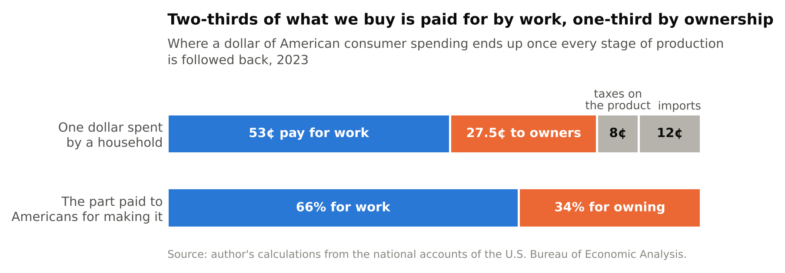

Set the tax and the imports aside and look only at what is paid to Americans for making the thing. Work gets 66 percent of it and ownership gets 34. Two-thirds and one-third.

There is a second way to get at the same number, from the other end. Ignore production entirely and ask households where the money they spent came from. The same agency publishes the incomes of American households sorted from poorest to richest, by kind: so much from pay, so much from interest and dividends and rents, so much in benefits. Match each group's spending to its income, add it up, and pay for work turns out to cover 66 percent of what households buy.

I should be honest about how firm that second figure is. Money isn't labeled once it's in a bank account, so deciding which dollar of income bought the groceries involves a convention, and stretching the convention as far as it will go in each direction gives anything from 53 to 80 percent. What makes me trust the middle is that it lands on the first count, which shares none of its assumptions. The two are built from different records by different methods, and over the twenty years in which both exist they differ by one cent in the dollar on average and never by more than two and a half.

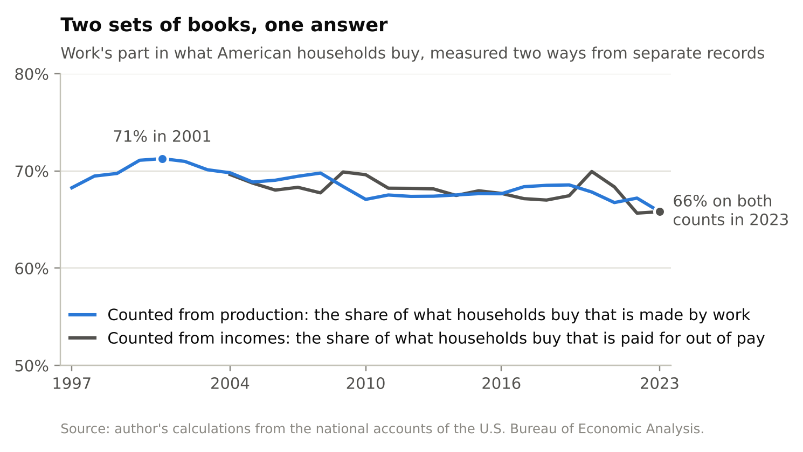

So that is the reading on the dial. Two-thirds of what we buy is paid for by work and one-third by ownership. It has drifted: work's share was 68 percent in 1997, 71 at its peak in 2001, and 66 in 2023.

## Does it matter which kind you get?

It wouldn't if you got all three. Picture a household that gets two-thirds of its income from pay and one-third from owning things, the same mix as the economy as a whole. Now let the split move, so that work is paid less and ownership more. This household loses on its paycheck and gains the same amount on what it owns. It comes out even. I'll call a household like that balanced. A homeowner is balanced against rents in the same way. When rents in the neighborhood go up, a homeowner doesn't pay more, because they are their own landlord.

If every household were balanced, very little in the rest of this essay would matter. Machines could take over as much work as they liked, the split could go to half and half or to one part in ten, and each household would keep its share of a growing total.

Hardly any household is balanced.

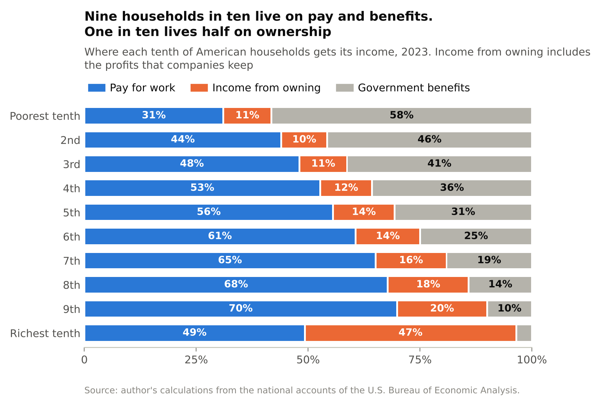

The chart sorts American households into tenths, from poorest to richest, and shows what each tenth lives on. The poorest tenth lives mostly on government benefits. From the second tenth to the ninth the picture barely changes: of what these households earn in the market, about four-fifths is pay for work. Then, in the richest tenth, it changes all at once. There, pay and ownership are about half and half.

Put the same facts another way. For every dollar the poorer half of households earns by working, it receives 24 cents from owning things. For the four tenths above them, the comfortable middle, it's 27 cents. A balanced household would have 51. The richest tenth has 96.

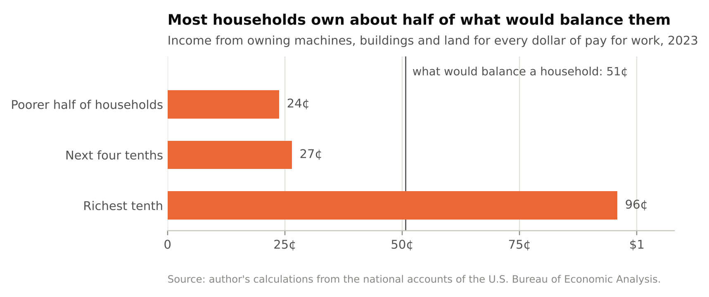

The richest tenth of households earns a bit over a third of all the pay for work in the country, and receives two-thirds of all the income from ownership. Nine households in ten are on one side of this and one in ten is on the other, and the nine include a great many people who think of themselves as doing fine.

You might object that benefits and pensions are a second source of income for those nine. They are less separate than they look. A benefit is paid out of taxes, and 68 cents of every tax dollar in America is raised from pay for work (somewhere between 63 and 73, depending on how you classify the taxes on mixed kinds of income). A public pension paid from this year's payroll taxes is a claim on this year's wages under another name. Follow the money far enough and most of us turn out to be living on each other's wages.

That sentence took me a long time to see, and I think it is the center of the whole subject. We live off the earth and off the machines we've built on it. But the route by which most people get their part of what the earth and the machines produce runs through one narrow channel, which is being paid for work.

## Why has that worked so well?

For about two hundred years, living on wages alone was a good position to be in. It's worth being clear about why, because the reason is also the weak point.

A machine can do something for you in only two ways. Either it needs you, or you own it.

Suppose houses are built by people with tools. I can't build a house, but I can do something else that people want, and I trade my hours for the builders' hours. Better tools make the builders faster and the house cheaper, and I share in that, because the house still can't be built without people and people are who I'm trading with. Now suppose houses are built by machines alone. The house is cheaper still. But I have nothing to trade for it. The machine doesn't want my hours. It wants nothing from me at all. The house reaches me only if I own a piece of the machine, or if someone who does chooses to pass it on.

The machines of the industrial age needed people badly. They were strong and stupid. They could lift, spin, stamp and haul, and they couldn't see, judge or decide. Nearly everything worth making took both kinds of ability at once, so every new machine created work for the people standing next to it, and the owners of machines had to bid against each other for those people. That is why wages rose with the machines. Nobody's generosity came into it.

Economists have a careful version of this. Daron Acemoglu, who shared the Nobel prize in economics in 2024, and Pascual Restrepo describe production as a long list of tasks, each done by whichever of a person or a machine does it more cheaply. New technology can do two different things to the list. It can take tasks over from people, which in their analysis "reduces employment and the labor share, and may even reduce wages." Or it can create new tasks that people are better at, which "has the opposite effects." For most of the industrial age wages rose, which tells you the second kept ahead of the first. Nothing in the logic says it always will. It depends on what kind of machine is being invented.

The kind being invented now can see, read, write and decide. I write software for a living and use these systems every day, and I find it harder each year to name a kind of work that is safely out of their reach.

## Has anything changed yet?

Start with a prediction that half came true.

In 1930, with the Depression setting in, the economist John Maynard Keynes wrote a short essay about the world his grandchildren would live in. He made two forecasts for a hundred years on. The first was that "the standard of life in progressive countries one hundred years hence will be between four and eight times as high as it is to-day." The second was that with so much plenty we would hardly need to work. "Three-hour shifts or a fifteen-hour week" would be enough, and the real problem would be how to fill the time.

The first forecast has held up remarkably well. In 2024, with six years still to run, output per person in the United States stood at 7.8 times its level in 1930.

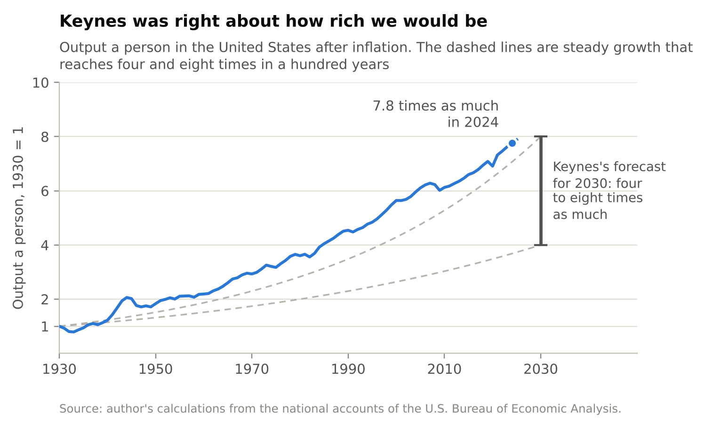

The second forecast failed. The forty-hour week was written into American law by an act of 1938, and the law still says forty.

Why did we get the wealth and so little of the time? There are several reasons and people argue about them, but one is sitting in Keynes's own sentence. The leisure, he wrote, would be won for us by "science and compound interest." Science did its part. Compound interest is a different matter. It is paid to whoever holds the thing that compounds.

A balanced household, in the sense I described, receives the gains of progress whichever way they happen to arrive, as higher pay or as higher returns on what it owns. A household living on pay alone receives them only to the extent that they arrive as pay. So look at pay.

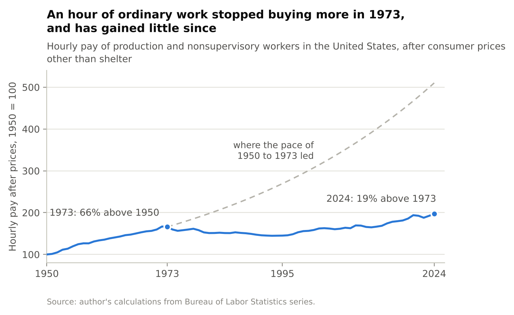

The chart follows the hourly pay of ordinary American workers, meaning everyone on a private payroll who isn't a manager or a supervisor, measured against the prices of everything except housing. (Housing has its own story, which comes later.) From 1950 to 1973 it grew by 2.2 percent a year, and by 1973 an hour of work bought 66 percent more than it had in 1950. Then it stopped. From 1973 to 1995 it fell by 0.6 percent a year. Since 1995 it has grown again, by 1.1 percent a year. In 2024 an hour of ordinary work bought 19 percent more than it had in 1973, fifty-one years earlier. If the earlier pace had held, it would have bought 2.6 times what it does.

It would suit my argument to tell you that this is the dial turning, and that the missing wage growth went to the owners of machines. Most of it didn't. The gap between where pay is and where the old pace would have put it can be divided up, and the division is humbling. Slower growth in what an hour of work produces accounts for 42 percent of it. Pay spreading out among workers, so that the average pulled away from the ordinary worker, accounts for 30 percent. The shift of income from pay to ownership accounts for 16 percent. The remaining 13 percent I can't assign. Count housing costs in and the gap is a little wider, and the rising price of shelter is 8 percent of that wider gap. The parts that are a move from work to ownership come to a little over a fifth.

The last twenty years say the same thing in a different way. Between 2004 and 2023 the part of households' market income (what they earn before taxes and benefits) that is pay for work fell from 71 percent to 66. That shift, taken alone, moved 1.4 percent of all market income to the richest tenth of households. In the same years that tenth gained twice as much again, 2.8 percent, by earning a larger share of each kind of income, pay included.

I'll add a guess, and label it as one. I suspect the true share is larger than a fifth, because the second-largest piece, pay spreading out among workers, may be the same force at work inside the wage bill. Acemoglu and Restrepo estimate that between 50 and 70 percent of the change in America's wage structure over the four decades to 2016 came from "relative wage declines of worker groups specialized in routine tasks in industries experiencing rapid automation." If something like that proportion applies to the spreading-out I measured, which is a leap, then about a third of the missing wage growth traces back to the kind of machines we have been building. The largest piece, slower growth overall, isn't explained by any of this, and I don't have an account of it that I'd defend.

So the honest reading is this. The dial has turned a little. The damage it has done so far is real and small. I find that reassuring for a reason I'll come to, which is that it means the remedy is still cheap.

## What if machines get much better?

Nobody knows whether they will, or how fast. What I can do is show what happens in an economy where they do, provided the rules of that economy are written down plainly enough to be worked out. That's all an economic model is: a small economy on paper, simple enough to solve and fitted to the real one wherever the two can be compared. The one I'll use has five rules.

1. There is a long list of tasks. People are far better than machines at some of them and only a little better at others, and there is a limit to how much better they can be at any.
2. Businesses give each task to whoever does it more cheaply, a person or a machine.
3. Machines have to be built, out of the work of other machines, some human work, and some land, by which I mean materials, energy and somewhere to stand.
4. Whoever pays for a machine wants a return on the money, 10 percent a year, and won't build it otherwise.
5. There is only so much land.

Fitted to the United States of the mid-2020s, this economy pays 60 percent of its income for work, 31 percent to the owners of machines and 9 percent to the owners of land. (That 60 is measured a little differently from the 66 above. The difference doesn't matter for what follows.)

Now turn one dial. Let machines get better at every task, in step, until they are a hundred times better relative to people than they are today, and let them gradually learn to build one another without human help.

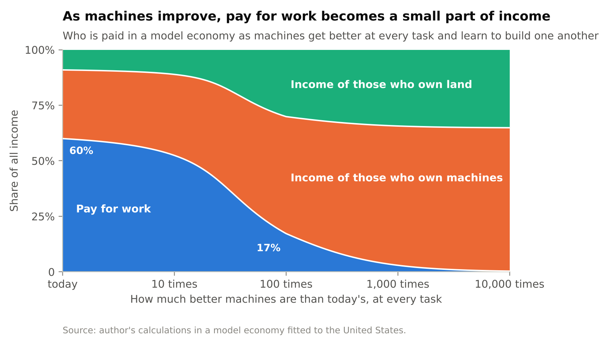

The first surprise is how little happens at first. When machines are ten times better, work is still paid 52 percent of all income, because people move to the tasks where their advantage is greatest and there is plenty for them to do. The second surprise is how suddenly that ends. When machines are about 35 times better a threshold is crossed: the machines that could replace even the hardest hour of human work now take less than an hour of human work to build, counting the work inside everything that goes into them. Before that point the best of what people do is safe. After it, no wage can stay above the cost of the machine that would do the job, and that cost is made of nothing but returns to owners and rent on land. By the hundredfold point work is paid 17 percent of all income. At ten thousand times it is paid less than 1 percent, with 65 percent going to the owners of machines and 35 to the owners of land.

Now the part that surprised me most, because it is not the story anyone tells. Nobody in this economy gets poorer.

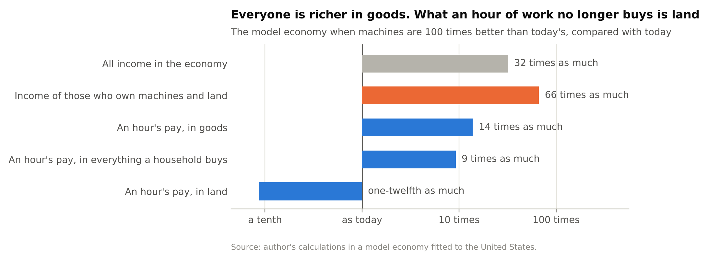

At the hundredfold point total income is 32 times what it was. An hour of work buys 14 times as many goods as it does today. Counting everything a household buys, land included, an hour's pay goes 9 times as far.

What an hour of work stops buying is land. The rent of land rises about a hundredfold, and an hour's pay rents about a twelfth of the land it does now. Meanwhile the income of those who own machines and land is 66 times what it was. Everyone has more goods. The owners have more of everything, and the things that can't be multiplied, which in this economy means land and ownership itself, move out of reach of a wage.

Then wages stop. Past the hundredfold point the hourly wage levels off at around ten times today's, while the economy goes on to grow more than fiftyfold again. People who live on wages find themselves in a long standstill in the middle of the largest boom there has ever been.

The other thing I didn't expect is who the winners are. I came to this subject believing that in the end everything would come down to land, the one thing that can't be made. Land does well: its share of income more than triples. But the larger winners are the people who own machines, whose share goes from 31 percent to 53 and then to 65. That needs explaining, because no machine is scarce. You can always build another. The explanation is that building takes time, and whoever puts up the money waits for it and wants paying for the wait. As machines take over more of the work there are vastly more of them, over fifty times as many at the hundredfold point, and each still pays its owner the going rate.

How much goes to machines and how much to land depends on that going rate. If investors came to accept 5 percent a year where they now want 10, which could happen in a world awash with savings, the same model gives land the larger share and machines the smaller. The share paid for work comes out about the same either way.

And then the result that worries me more than any other. I think of it as a door.

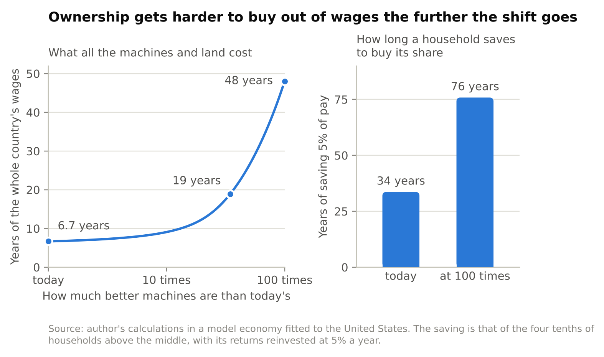

Today, everything that pays ownership income in this economy, every machine and every acre, is worth about 6.7 years of the whole country's wages. That's the price of the lot, measured in the only currency most households have. At the threshold it is 19 years. At the hundredfold point it is 48. The reason is simple enough. Ownership is paying more and more, wages are a shrinking share, and the price of one in terms of the other can only go one way.

What that means for a family is in the right-hand panel. Take a household in the comfortable middle that wants to buy enough ownership to be balanced. Putting aside 5 percent of its pay, and earning 5 percent a year on what it has saved, it gets there in 34 years at today's prices. At the hundredfold point the same saving takes 76 years. (Both figures assume that the common fund I describe later is already in place.)

So the households that most need to own something are the ones who would have to buy it out of wages, and wages are the thing losing its value. Waiting to see whether the shift is real means waiting until the people it hurts can no longer afford the cure.

Three cautions about all this.

The dial measures technology and not time. A hundredfold improvement takes 117 years at 4 percent a year, which is the pace at which machinery improved for its price in the decades after the Second World War, on a well-known measurement by the economists Cummins and Violante. At 10 percent a year it takes 48 years, and at 20 percent, 25. I don't know which of those is closest to what's coming. Neither does anyone else.

The outcome depends on the first rule. If there is no ceiling on human advantage, so that there are always some tasks where one person is worth any number of machines, the same dial lowers work's share to 48 percent and stops there. Economists disagree about this, with serious work on each side. Francesco Caselli and Alan Manning showed in 2019 that new technology is unlikely to lower the wages of all workers, and that it raises the average wage as long as machines keep getting cheaper relative to consumer goods. Anton Korinek and Donghyun Suh showed in 2024 that wages collapse if the tasks people can perform are bounded in difficulty and all of them come to be automated. My own guess is that the ceiling is real for most people at most tasks, which puts me nearer the second pair. I hold that loosely.

And the model is a model. It has no unemployment in it, no monopolies and no politics. It has one kind of worker, so it cannot show what the wage figures showed for the real economy, which is that average pay can rise while ordinary pay stands still. And it describes where the economy settles at each level of technology and says nothing about how rough the journey between them is.

## Won't the economy seize up if nobody can afford anything?

This is the most common objection I hear, and for a long time I believed a version of it myself. Businesses need customers. If nobody has wages, nobody can buy, so the owners of the machines will have to keep people in work, or pay them somehow, out of self-interest.

It doesn't hold. In the model economy at the hundredfold point income is 32 times larger, and none of it has vanished. It has arrived in fewer hands, and those hands spend it and invest it like anyone else's. The owners are the customers.

An economy is, among other things, a way of finding out what people want and making it, and it counts votes in dollars. If ownership stayed as it is today and work were paid 17 percent of income, the richest tenth of American households would receive 62 percent of all market income, up from 46. The four tenths below them would go from 39 percent to 28, and the poorer half from 14 and a half to 10. The economy would not stall. It would turn to face the people with the votes, and make more of what they want and less of what everyone else wants.

There is no law of economics that says an economy has to be for everybody. Whether it is depends on who holds the right to be paid, and that is something we decide.

## Why not just tax the machines?

That was my first answer too. If the income is going to the owners of machines, tax it and hand the money round. In the model this fails, in a way that taught me something.

Put a 20 percent tax on what machines earn their owners. Once everything has adjusted, the tax raises 6.3 percent of national income. Wages fall by 6.1 percent of national income. The economy as a whole is 6.5 percent smaller. If every dollar the tax raised were handed straight to wage earners, they would end up 0.3 percent better off than before the tax existed.

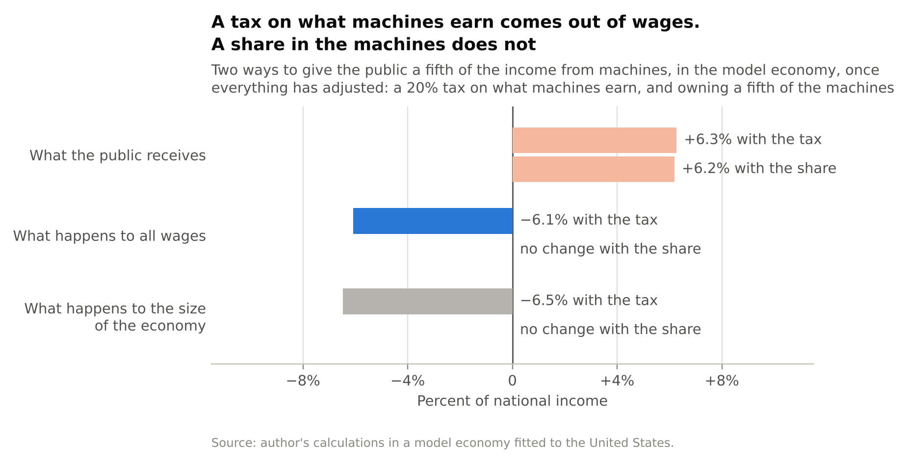

Here is what happens. Investors build machines up to the point where the last one just pays the return they require. Tax the return, and the last machine no longer pays. So they build fewer, and keep cutting back until machines are scarce enough to earn the old return after tax. The owners end up with the same rate of return on a smaller pile, about a fifth smaller in the model. The people who work alongside machines end up with fewer machines to work with, produce less, and are paid less. The tax has gone straight through the owners and landed on the wage.

The same logic is behind a classic result in the study of taxation, due to Christophe Chamley and Kenneth Judd in the 1980s: in the long run, the best tax rate on the income from capital is zero. I should add that the result has been challenged, by Ludwig Straub and Iván Werning in 2020, and that it rests on investors being free to hold back. In the short run they aren't. The machines already exist, and a new tax falls on whoever owns them. Over a generation, I believe the model.

But the model also says there is a way to take the same fifth that disturbs nothing. Leave what the machines earn untaxed, and own a fifth of the machines.

There are two ways to come to own them. One is to buy them, as any investor does, which at today's prices costs about a year of the whole country's wages for a fifth of all the machines. The other is odder and cheaper, and it runs through the tax system. Suppose a company may deduct the full cost of every investment from its taxable profit on the day it makes it. Then on every new machine the government is, in effect, putting up a fifth of the cost, through the tax it gives up, and collecting a fifth of what the machine earns. That is a partnership. The investor's return on their own four-fifths is untouched, so they build exactly as many machines as before. The public gets its fifth of the income, which is 6.2 percent of national income in the model, and wages and the size of the economy don't change. Economists have known about this arrangement for a long time and call it a cash-flow tax.

The catch is the machines that already exist on the day the rule changes. Nobody put up a fifth of their cost on the public's behalf, yet the public starts collecting a fifth of what they earn. For their owners that is a one-time loss of about a fifth, and it should be called what it is.

Neither route is exotic. The United States already taxes company profits at 21 percent. Moved onto this footing, the same rate becomes a public stake of about a fifth. And Norway has done the buying version for a generation with its oil money. Its national fund now owns, in its own words, "almost 1.5 percent of all shares in the world's listed companies." Less than half of the fund's value is oil money that was paid in. The rest was earned by the investments. And the small part the government is allowed to spend each year "still amounts to almost 20 percent of the government budget."

## What about land?

Land is the exception to everything in the last section, for one reason. Nobody makes it. Tax machines and there will be fewer machines. Tax land and there is exactly as much land as before, in exactly the same places.

This is an old idea with a distinguished history. Thomas Paine, the pamphleteer of the American Revolution, argued in 1797 that "Man did not make the earth," so that "every proprietor therefore of cultivated land, owes to the community a ground-rent," and he proposed paying it into a national fund from which every person would receive a sum of money on turning twenty-one. "It is not charity but a right," he wrote. Eighty years later Henry George, a self-taught American journalist, built a whole movement on the same point with a book called *Progress and Poverty*. His formula was: "It is not necessary to confiscate land; it is only necessary to confiscate rent."

I reached this idea on my own before I had heard of either of them, which I've decided to find encouraging. And for a while I believed a tax on land was most of the answer. The numbers talked me out of that.

Start with how much there is. I can measure the rent of the ground under America's homes, as distinct from the buildings on it. In 2024 it came to between 4.3 and 7.1 percent of households' disposable income, which is between $2,776 and $4,627 a year for every person in the country. (The range is there because nobody can say exactly how much of a home's value is the building and how much is the ground. I've used three-tenths and a half.) Collected in full and shared out equally, it would cover between 18 and 58 percent of a bare poverty-line budget. That leaves out the land under offices and factories, and what oil and minerals pay, so the true figure is higher. It is still not something a whole country can live on.

Why is it so small, when everything we eat and wear and live in comes out of the ground? Competition. Imagine two iron mines with different owners, either of which could supply everyone. Each owner will undercut the other until the price of ore covers the cost of digging it up and no more, and the rent on both mines is nothing. Rent is paid only for what has no second source: the mine that is cheaper to work than the next one, the plot in the city where everyone wants to be. Most of what we take from nature has a second source. That is good news, and it has a consequence that took me a while to accept. An economy can't both have resources to spare and live on the rent from them.

That is the position now. If machines improve, land's share of income more than triples in the model, and it is the one kind of income that can be collected at no cost to anyone's reasons for doing anything. So land matters more the further the dial turns.

It matters already in one way. Shelter is the one large thing we buy that work hardly makes. Work makes 74 percent of everything else in the household budget and 23 percent of shelter, because most of what you pay for a home goes to the owners of the building and the ground. A dividend paid out of land rent goes up when rents go up. For anyone who rents their home, that is protection against the one bill that has risen fastest against wages.

The difficulty is getting from here to there. The price of a piece of land is the rent it is expected to earn, added up over the future. Announce a tax that takes the rent and you have taken the price, that morning, from whoever happens to own it, and most of them paid full price. My rough calculation for the United States is that a land tax large enough to pay every adult about $250 a month would take something like 85 percent off the value of residential land. The people paying would be ordinary homeowners, and those over sixty-five would make 45 percent of the net payments. I don't think that can be done to people, and I don't think it should be. Paine didn't either. "The fault, however, is not in the present possessors," he wrote.

So tax only the growth. Leave every owner the rent they receive today and collect what is added from here on. The tax is just as harmless to the working of the economy, and it takes much less from the people who own land on the day it starts. What it takes is the part of today's price that was a bet on future growth, which by the usual arithmetic is about 40 percent of the land's value, against 85. For a house whose value is three-tenths to a half land, that is 12 to 20 percent off the price. That is still a real loss. I think it's a fair division between people who bought in good faith and a public with a claim on what nobody made, and you may think the line belongs somewhere else.

## So what do we do?

Put the pieces side by side and they nearly dictate an answer.

The income that is growing is ownership income, most of it from machines. It can't be shared by taxing it, because the tax lands on wages. It can be shared by owning it. Land's income can be taxed, gently, out of its growth. Wages are what most households have to buy ownership with, and they buy less of it every year the dial turns. And the taxes that fund every benefit rest mostly on wages, the one kind of income that is at risk.

So start owning, in two ways, now, and move the tax system off the wage. Here is what that looks like for the United States, with sizes.

| | What America does now | What would change |
|:---|:---|:---|
| Company profits | Taxed at 21 percent by the federal government. All levels of government raised $608 billion from them in 2023, for their general budgets. | The same rate, with investment deductible in full. The revenue becomes the income of a public stake of about a fifth, and is paid out to everyone equally. |
| Land | Taxed only together with the buildings on it, through property taxes, which raised $697 billion. | A tax on the growth of land rent is added. The rent that owners receive today is left alone. |
| Saving for old age | 12.4 percent of wages goes to Social Security, which pays today's pensions out of today's wages. | A further 5 percent of pay is saved into invested accounts that belong to the worker. |
| Taxes on work | 68 percent of all tax revenue is raised from pay. Payroll contributions alone are a quarter of everything collected. | Payroll contributions are replaced, step by step, by a tax on spending that raises the same amount. |
| Money paid to everyone | None. Benefits of $4,144 billion a year are tied to age, to past work or to low income. | An equal dividend from what is held in common. |
| What machines earn | Taxed through the tax on company profits and through personal taxes on interest, dividends and gains. | No new tax. |

: What the United States does now, and what would change. Amounts are for 2023.

### Own a fifth in common

Suppose a fifth of all the machines and land in the country were held on behalf of everyone, and what that fifth earned were paid out equally, the same to each person. In 2023 it would have paid $4,493 a person, or $374 a month, for every man, woman and child. That is more than Social Security pays out per head of population.

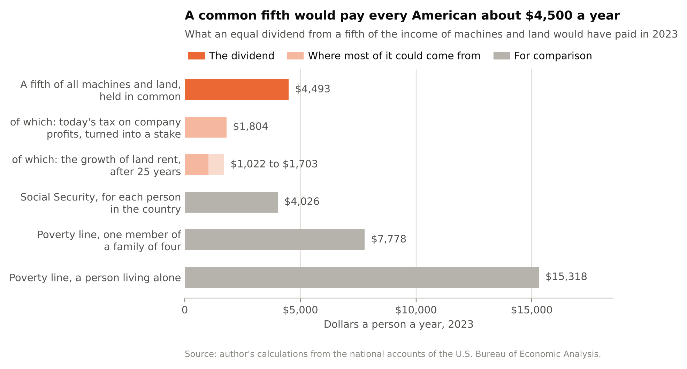

Most of that fifth is within reach without buying anything. Today's tax on company profits, turned into a stake as I described, is worth 8 percent of all ownership income. A tax on the growth of land rent collects nothing in its first year and about two-fifths of the rent after twenty-five years of growth at 2 percent a year, which comes to another 5 to 8 percent. Together that is about a seventh of all ownership income. Charges for using other things that nobody made, such as the airwaves and the atmosphere, would add to it, and I haven't measured those. A public fund on the Norwegian pattern could buy the rest.

Why a fifth? I have two reasons, one better than the other. The weaker one is that it's about what America already takes from company profits, so it asks for a change of form more than a change of size. The better one is what it does. A common share of about a seventh is what it takes to keep the poorer half of households whole, meaning that their share of the nation's market income would not fall at all even if wages went to nothing. A fifth does a little better than that. With a common fifth, the poorer half would have 48 cents of ownership income for every dollar of pay, against the 51 that would balance them exactly.

I should be plain about what this costs, because a dividend can sound like free money. It isn't new income. It is a fifth of the income that machines and land already earn, paid to different people. The part that comes from the profits tax is money that governments spend today, so paying it out means finding $608 billion a year somewhere else, and the tax on spending described below is where I would look. The part from land comes out of gains that landowners were expecting. And whatever a fund buys, somebody pays for, by spending less in the meantime.

None of this is untried. Since 1982 the state of Alaska has paid every resident a yearly dividend out of a fund built from its oil revenues. It paid $1,312 a person in 2023 and $1,702 in 2024, to more than 600,000 people each year, and the fund behind it is worth $88 billion.

### Buy the rest out of wages

A common share can protect the poorer half. It cannot do the same for the comfortable middle, the four tenths of households above the halfway mark. They earn nearly half of all the pay in the country, so they have the most to lose when pay shrinks, and no common share short of six-sevenths of everything would keep them whole. With a common fifth in place they would still be 21 cents short, for every dollar of pay, of the ownership income that would balance them.

They have to buy it, and the arithmetic is the one from the door. At a 5 percent return, the holding they need is worth 4.2 years of their pay. Saving 5 percent of pay and reinvesting what it earns builds that in 34 years, which is a working life. Wait until the hundredfold point and it takes 76.

America already takes a much larger slice of wages for retirement, 12.4 percent, for Social Security. But Social Security owns nothing. It pays this year's pensions out of this year's wages, which makes it one more claim on the wage. What I'm describing has to be invested, across the whole market, in accounts that belong to the worker. Sweden, where I live, runs a small version. Of the 18.5 percent of pay that goes toward the public pension, 2.5 goes into what is called a premium pension, invested in funds the worker chooses or in a state-run default fund.

### Move taxes off work

The third part is about what the government stands on. Sixty-eight cents of every tax dollar is raised from pay, and a quarter of everything collected is payroll contributions, a tax on wages and nothing else. Every benefit paid out of that money is a claim on wages at one remove. The safety net depends on the same thing as the incomes it is there to protect.

A broad tax on spending behaves differently. It follows the spending, wherever the income behind it came from. America has no such tax at the national level. Today the switch would change little: pay for work covers 66 percent of what households buy, so a tax on spending would be paid out of wages in about the same proportion as the payroll taxes it replaced. The difference shows up only if the split moves. At the hundredfold point in the model, five-sixths of a tax on spending would be paid out of ownership income. The tax would have followed the money without anyone passing a new law.

I used to think that a tax on spending paying for an equal dividend could carry this whole problem by itself. It can't yet, for the reason just given: for now it mostly moves money from wage earners to wage earners. It becomes the right instrument later, and it is worth having in place before then.

### Three things not to do

Don't add a tax on what machines earn, or on robots. In the model it costs wages 6.1 percent of national income for every 6.3 it raises.

Don't promise a full basic income out of today's taxes. I come to that next.

And don't wait for proof. The part of this that has to be bought will never be cheaper than it is now.

Here is what the first two parts would do in the hard case, where work is paid 17 percent of income.

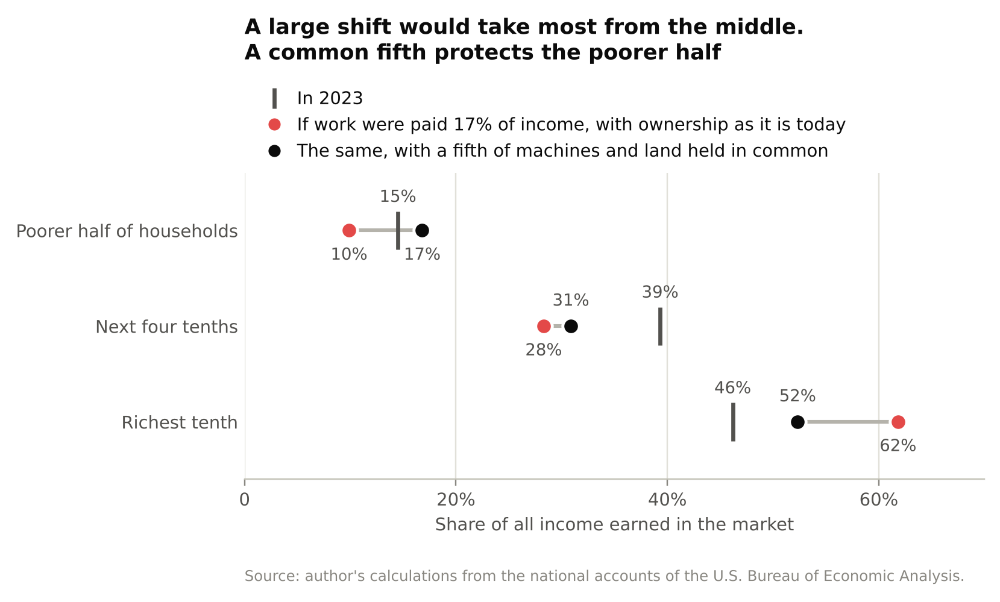

With ownership as it is today, the richest tenth's share of market income goes from 46 percent to 62. With a fifth held in common it goes to 52, and the poorer half ends up with 17 percent, which is more than it has now. The comfortable middle still falls, from 39 percent to 31. That remaining gap is what the saving is for.

## Isn't this just a universal basic income?

In form the dividend is one. Everyone gets it, the same amount, with no conditions. In substance it differs in three ways that I think matter a great deal.

It is not a transfer from people who work. A basic income paid out of today's taxes would be, for 68 cents in the dollar, wage earners paying each other. The dividend is the income of something the public owns. Paine's distinction applies. It is a right, and it is not charity.

Its size isn't a promise. It is whatever the common share earns. Today that is $374 a month, which is 58 percent of the poverty line for one member of a family of four and 29 percent for a person living alone. Nobody retires on it.

And it grows when it is needed. In the model the income of a common fifth is 13 percent of all wages today, and 96 percent of all wages at the hundredfold point. It is small while wages are doing their job and large when they aren't, without anyone having to vote it up.

Could we afford a full basic income instead, enough for everyone to live at the poverty line? More easily than ever before, which surprised me.

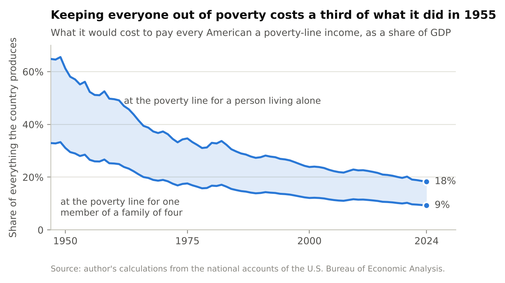

In 1955 it would have cost between 27 and 52 percent of everything America produced, depending on whether you price it for a member of a family of four or for a person living alone. In 2024 it would cost between 9 and 18 percent. The country has become rich enough that keeping every one of its people out of poverty would take about a third as much of its output as it would have seventy years ago.

But 9 to 18 percent of the country's output raised through today's tax system would be raised mostly from wages, and it would leave who owns what exactly as it is. I would rather build the thing that grows.

Then there is the worry that people who are given money will stop working. The evidence we have says some will work a little less. Alaska is the best test of a small, permanent, universal payment, and the economists Damon Jones and Ioana Marinescu found that its dividend "had no effect on employment" and that part-time work rose by 1.8 percentage points. The best test of a large payment is an American experiment that gave 1,000 low-income people $1,000 a month for three years, more than two and a half times the dividend I'm describing. They worked one to two hours a week less than a comparison group, and about four in a hundred more of them were out of the labor force. The authors call that "a moderate labor supply effect."

So people who are given money work a little less. I used to treat that as the objection to be answered. I now think it is the most interesting finding in the subject, and it gets a section to itself.

## Are we already working more than we need to?

Everything so far has been about a risk, about what happens if the dial turns. This part is different. It would be true if machines never improved again.

Start with what a price is. When I pay three dollars for a loaf of bread, the baker learns something true about me: the bread was worth at least three dollars to me, because I could have walked away. A wage is supposed to carry the same kind of information in the other direction. If I take a job at fifteen dollars an hour, the hour must have been worth less than fifteen dollars to me, or I would have kept it. A great deal of economics leans on that inference. It is how governments put a cost on the labor that a project uses up, and it is why a job that somebody is willing to do is assumed to be a job worth doing.

The inference works only if I could have said no. If selling hours is the only way I eat, I will sell them for whatever they fetch, and the wage records how badly I needed the money. It says very little about what the hour was worth to me. It might have been an afternoon with my child, or a visit to my mother, or the Tuesday I would have spent running the club. Those lost a contest they were never allowed to enter. I have written out a formal version of this argument elsewhere. The plain version is that an auction in which one side can't walk away tells you very little about what the thing was worth.

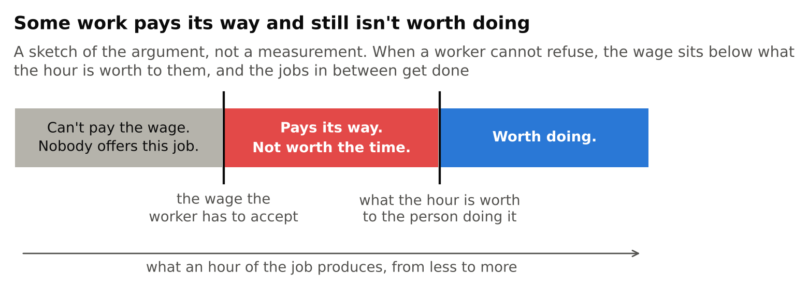

Two things follow. The first is that some work gets done that isn't worth doing. Take any job that produces a little more than the wage it pays and less than the hour is worth to the person doing it. The job covers its costs. The employer is doing nothing wrong. And every hour of it uses up something worth more than what it makes, with the whole of the loss falling on the worker. I call this make-work, and the trouble with it is that nobody can see it. All the prices look fine.

The second is that the statistics can't see it either. The hours worked by people who had no choice are a fact about what those people needed. They are no evidence that the work was wanted. I once asked a friend why we assume that everyone ought to be working, and she said of course they should, she'd like to be able to buy more stuff. It's a fair answer, and it contains an assumption, which is that every extra hour worked makes more of what we want. Labor is a resource, like water, and we don't drain the oceans looking for a use for every drop. We make matters worse by counting jobs as a good in themselves. In any careful accounting, the labor a project uses is a cost, because it is somebody's time. In politics it is counted as the benefit.

None of this needs robots. It needs only that ordinary pay stays low against what a life costs. An hour of ordinary work buys only a fifth more than it did fifty years ago, and housing costs more.

How much of today's work is like this? I can't tell you, and the argument itself says why. Wages and hours are precisely the records that cannot reveal it. The only way to learn what people's time is worth to them is to make refusing possible and watch what they do, and that is what the experiment I described a moment ago did. Its participants received $11,400 a year more than the comparison group, and their other income ended up about $1,900 a year lower. They took roughly a sixth of the money as time and kept the rest. In the authors' words, "the greatest increase generated by the transfer was in time spent on leisure," and they found no improvement in the quality of the jobs people held.

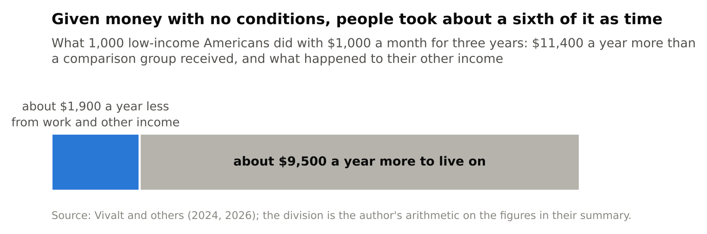

I read that as a caution against my own argument as much as support for it. People who could refuse a little did refuse a little, and an hour or two a week came back to them. But for most of them, most of the time, more money was more urgent than more time. Whatever the gap is between a wage and the worth of an hour, at those incomes it was not enormous. My guess is that it would be larger over a lifetime than over a three-year experiment, because people can't rearrange a life around money that is about to stop. That is a guess.

It would also be pleasant to call this a waste that could be recovered for nothing. It can't be, and the reason is the heart of the matter. The person who would gain from being able to say no has nothing to pay for the privilege with. That is their whole situation. So the gain can be had only if someone else funds the floor they stand on. It is a real gain that arrives looking exactly like redistribution, and I think that is why arguments about work and welfare go round in circles. Each side is right about the half it is looking at.

Two things soften this. One is that much of the time people would take back is worth something to others besides themselves: to the child, the parent, the kids in the clubhouse I describe below. The other is who owns what the floor is paid from. If it is paid from something that everyone holds a share in, people are in large part paying themselves, and the transfer shrinks. That is the common fifth again, reached from a different direction.

Keynes's fifteen-hour week needed two things. It needed the wealth, which came. And it needed ordinary people to be able to choose time over money, which means being able to turn work down without going hungry. A household that owned its share of what the machines and the land produce could make that choice. How many made it would tell us something we have never been able to measure.

## Is it fair?

Most of what I've proposed can be defended without any appeal to fairness. Moving taxes off wages raises the same money from a base that isn't shrinking. Swapping the tax on profits for a stake raises almost the same money and, in the model, undoes the damage of the tax, which was an economy 6.5 percent smaller and wages lower by 6.1 percent of national income. Saving out of wages is ordinary prudence. These are arguments about making the total larger or safer.

But in a few places somebody loses, and then a judgment about who ought to hold what can't be avoided. I'd rather make it in the open.

The standard I'll use is the one most often offered in defense of things as they are: that people are entitled to what they contribute, and that what you are paid measures what you add. I think that is a reasonable standard. My complaint is that we don't apply it.

Hold the kinds of income up to it. A wage is paid for work, which is a contribution if anything is. The return on a machine is paid to someone who went without something in order to build it, and saving is a contribution too. The rent of land is paid for something that nobody made, and holding the title adds nothing to it. And some ownership is inherited, by someone who did neither the work nor the saving. The standard is surer of the first two than of the last two.

Now look at what America taxes. It raises 68 percent of its revenue from pay for work, the most plainly earned income there is. Its tax on what machines earn falls, in the model, largely on wages again. And it taxes land only in a bundle with the buildings on it, which somebody did build. By its own favorite standard, the country taxes most heavily what is most clearly earned.

The program is that standard applied all the way through. Take taxes off work. Leave savers the return they require, and take the public's share of what machines earn as a partner. Collect the growth in the rent of land and divide it equally, because nobody has a better claim to it than anybody else. And let households come to own machines in the way the standard approves of, by saving out of what they earn.

There is a flaw in the standard itself, and it matters for what comes next. What you are paid measures what would be lost if you stopped, and that depends on what else could do your job. On the day a machine learns it, your contribution in this sense falls, though you are doing exactly what you did the day before. The standard rewards scarcity at least as much as it rewards effort.

So push it. Suppose machines can do nine-tenths of all work, and the remaining tenth can be done only by a tenth of the people. Does the standard break? I don't think it does. It still says that those who work should keep their pay and those who saved should keep their return. It has less and less to say, because less and less of all income is anyone's contribution.

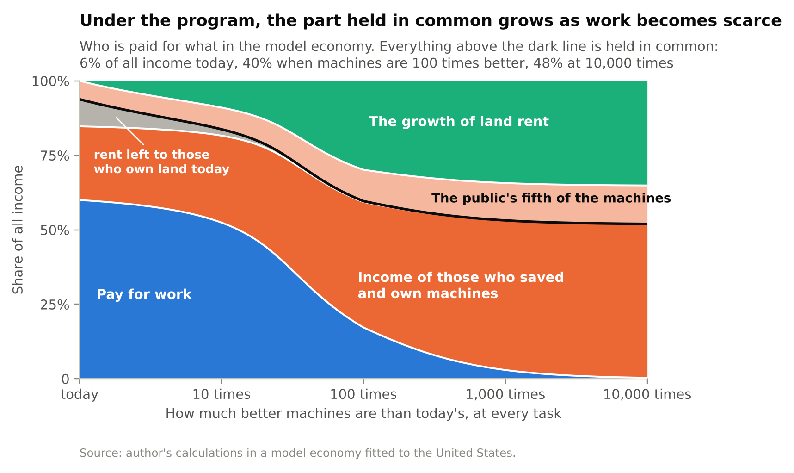

The chart shows who is paid for what in the model economy with the program in place. Pay for work goes from 60 percent of all income today to 17 at the hundredfold point and to less than 1 in the end. What is held in common, the public's fifth of the machines plus the growth in land rent, goes from 6 percent of all income today to 40 at the hundredfold point and 48 in the end. The remaining 52 percent goes to those who saved.

That is about half. If I had proposed at the outset that half of all income should follow contribution and half be shared equally, you would have been right to call the number arbitrary. I didn't choose it. It is where the contribution standard arrives by itself when work becomes scarce, given a public stake of the size America already takes and an economy that needs land. A different stake, or machines that needed less land, would give a different number.

Two things in all this remain plain choices, and I'd rather name them than hide them. One is the size of the stake. I've used a fifth because America already levies about that, and I have no deeper reason. The other is the person who can contribute nothing and owns nothing, which would be the position of anyone who came of age after wages had gone and whose family had saved nothing. The contribution standard has nothing to say about that person. A second principle is needed, that nobody should be left with nothing, and the dividend is how the program meets it. In the far limit of the model the dividend is 48 percent of the average income, for every person. Whether that is enough is beyond what I can measure.

Last, timing, which is where fairness and prudence meet. Today, moving toward balance is a trade. Households put aside some of their pay and buy ownership from people willing to sell it, and each side is paid in full for what it gives up. After a large shift, the same move is a transfer from those who gained to those who lost, and it costs more than twice as many years of saving. We are in the before. None of us knows for certain which side of the line our own work will fall on, and I can't think of a better condition for agreeing on a rule.

## What does money not fix?

A wage is more than money. It is a reason to get up, a place to be at nine, a way of being needed by somebody. A dividend replaces none of that, and I don't want to pretend otherwise.

What it might do is make room. There is a room in Stockholm that I think about, a clubhouse where a gaming association lets teenagers spend their afternoons. Kids who have nowhere else to be go there. It exists because of a public grant. No business would have built it, since there is no money in a place for lonely teenagers to be less lonely. When I look at what seems to have gone missing in my lifetime, the visits to grandparents, the clubs somebody used to run, the neighbor you used to know, the common thread is that none of it is paid. All of it takes time, and time is what a household living on wages alone has to sell.

A dividend doesn't build that room. Somebody still has to find the premises and do the boring organizing. But it lets the person who would run it on Tuesdays afford to. I can't prove the rooms would come back. I think some would.

An income can be paid out of what we own together. A place among other people has to be made by people, and it is one of the few things I'm confident the machines will leave to us.

## How sure am I?

I said I would sort the claims.

Measured, from public accounts, with every figure reproducible: that two-thirds of what Americans buy is paid for by work; that nine households in ten lean on pay more heavily than a balanced household would, while one in ten receives two-thirds of the ownership income; that 68 percent of taxes rest on pay; that the shift from pay to ownership has so far been small; the wage figures; the size of land rent; and the falling cost of keeping everyone out of poverty.

From a model, and true to the extent that its rules hold: what happens when machines improve a hundredfold; that a tax on what machines earn lands on wages; that ownership costs more in years of wages the further the shift goes; and that the common part of income rises to about half. From argument alone, with no model behind it: that a wage says little about the worth of an hour to someone who cannot refuse it.

My judgment, and nothing firmer: that the dial will keep turning, and faster than it has; that human advantage has a ceiling for most of us at most tasks; that about a third of the wage growth lost since 1973 traces to the kind of machines we built; that a good deal of today's work would not be done if the people doing it could afford to refuse; and that a country where a tenth of the households receive three-fifths of the income, and the other nine-tenths have the votes, will not stay calm.

There are also things I have left out that could change the picture. I gave every household the same average shopping basket, and renters are worse placed than that makes them look. I lumped the richest tenth together, though ownership is concentrated within it. The model has no risk in it, and real households that hold shares can lose money on them. And everything here is American.

What would change my mind? Three gauges are worth watching: the share of what we buy that is paid for by work, which was 71 percent in 2001 and 66 in 2023; the price of ownership in years of wages; and who owns what. If the first of those rises for a decade, I'm wrong about the direction. In that case the program will have cost a tax reform, a savings plan and a modest dividend, and I wouldn't regret any of them.

## So where do people get the money?

From the same three places as always: from working, from owning what was built, and from owning what wasn't. The machines don't change that. They change the proportions, and the proportions are a problem only because most of us hold one of the three.

I started with a world where machines do everything and asked where people would get money. The answer turned out to have been in plain sight. In that world people have money if they own a share of what produces, and it is a comfortable world if nearly everyone does. Whether they will is not a question about technology. It gets settled earlier, in ordinary years like these, by who is buying what, and with what, while a year's pay still buys what it buys today.

I would be glad to be wrong about where the dial is heading. But the case for doing this doesn't depend on my being right. Part of it is about the present: a person who must sell every hour in order to eat cannot tell us what their time is worth, and we are all poorer for not knowing. The rest is what I have measured, which is who would bear the cost if I am right, how little those households hold apart from their work, and that the price of changing it goes up with every point that work's share falls. That seems to me reason enough to begin.

---

*How this was made.* I wrote this with Claude, Anthropic's AI model, which did the measurements with me, drew the figures and drafted most of the text from my earlier essays. The model economy is joint work with Johan Båge. Every number comes from code in a public repository, with checks that fail if the text and the data disagree, and every quotation was read at its source.

## Sources

The measurements are my own calculations from the national accounts of the U.S. Bureau of Economic Analysis: the input–output accounts, the distribution of personal income and of consumer spending by tenth of households, and the accounts of government receipts and benefits. The wage series are from the Bureau of Labor Statistics. The poverty line is that of Mollie Orshansky, "Children of the Poor," *Social Security Bulletin* 26(7), 1963, updated for prices.

Works quoted or relied on, in the order they appear:

- Wassily Leontief, "Quantitative Input and Output Relations in the Economic Systems of the United States," *The Review of Economics and Statistics* 18(3), 1936. Nobel prize citation: nobelprize.org, economic sciences, 1973.
- Daron Acemoglu and Pascual Restrepo, "The Race between Man and Machine," *American Economic Review* 108(6), 2018.
- John Maynard Keynes, "Economic Possibilities for our Grandchildren," 1930, in *Essays in Persuasion*.
- Fair Labor Standards Act of 1938, section 7; 29 U.S.C. § 207.
- Daron Acemoglu and Pascual Restrepo, "Tasks, Automation, and the Rise in U.S. Wage Inequality," *Econometrica* 90(5), 2022.
- Jason Cummins and Giovanni Violante, "Investment-Specific Technical Change in the United States (1947–2000)," *Review of Economic Dynamics* 5(2), 2002.
- Francesco Caselli and Alan Manning, "Robot Arithmetic: New Technology and Wages," *American Economic Review: Insights* 1(1), 2019.
- Anton Korinek and Donghyun Suh, "Scenarios for the Transition to AGI," NBER Working Paper 32255, 2024.
- Christophe Chamley, "Optimal Taxation of Capital Income in General Equilibrium with Infinite Lives," *Econometrica* 54(3), 1986. Kenneth Judd, "Redistributive Taxation in a Simple Perfect Foresight Model," *Journal of Public Economics* 28(1), 1985. Ludwig Straub and Iván Werning, "Positive Long-Run Capital Taxation: Chamley-Judd Revisited," *American Economic Review* 110(1), 2020.
- Norges Bank Investment Management, "About the fund," nbim.no.
- Thomas Paine, *Agrarian Justice*, 1797. Henry George, *Progress and Poverty*, 1879.
- Internal Revenue Code, 26 U.S.C. §§ 11, 3101 and 3111, for the rates of the corporate income tax and of the Social Security tax.
- Alaska Department of Revenue, Permanent Fund Dividend Division, "Summary of Dividend Applications and Payments," pfd.alaska.gov. Alaska Permanent Fund Corporation, apfc.org, fund value as of September 30, 2026.
- Swedish Pensions Agency, "National public pension," pensionsmyndigheten.se.
- Damon Jones and Ioana Marinescu, "The Labor Market Impacts of Universal and Permanent Cash Transfers: Evidence from the Alaska Permanent Fund," *American Economic Journal: Economic Policy* 14(2), 2022.
- Eva Vivalt, Elizabeth Rhodes, Alexander Bartik, David Broockman, Patrick Krause and Sarah Miller, "The Employment Effects of a Guaranteed Income: Experimental Evidence from Two U.S. States," NBER Working Paper 32719, 2024; *The Quarterly Journal of Economics* 141(4), 2026.
