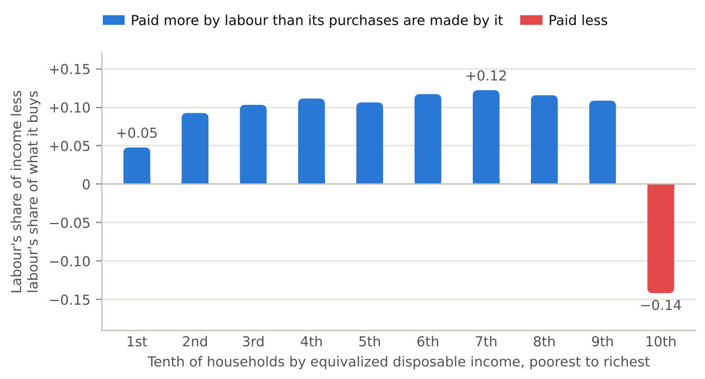
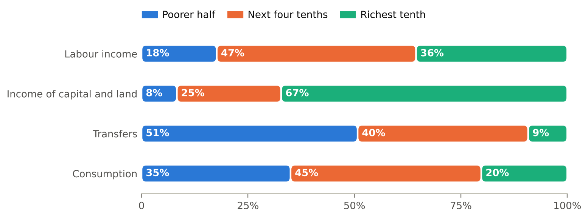
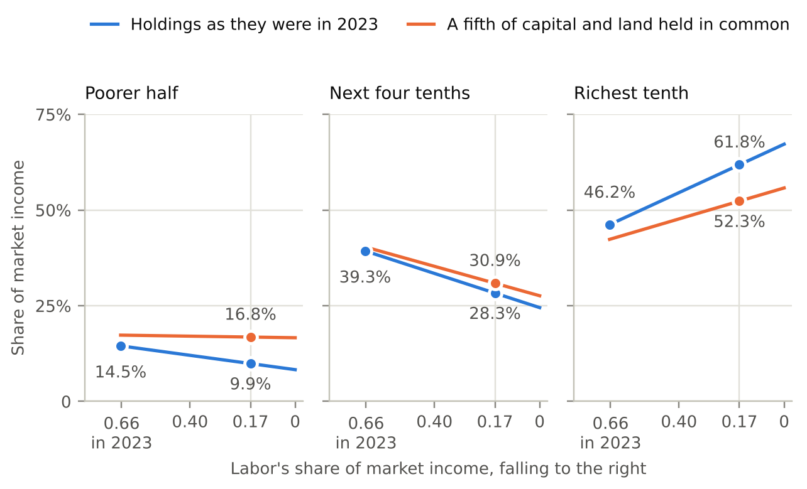
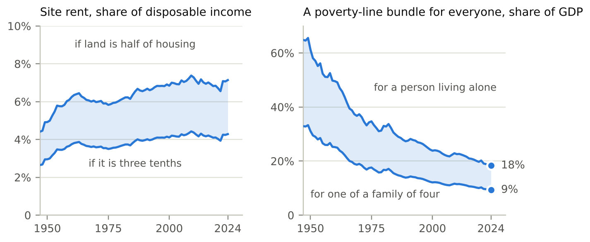
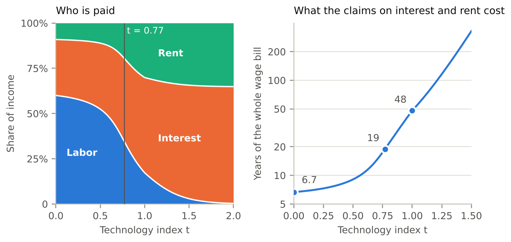
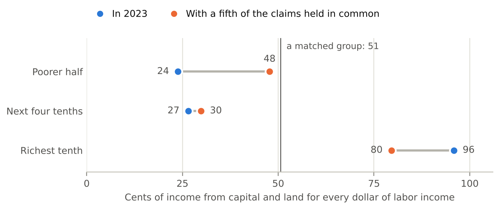

> **Drafting note, to be removed.** Drafted by Claude for Stella Wilson. Every number comes from the scripts described in Appendix B, and a check confirms that the text prints what they produce. Some things are provisional. The wage accounting in Section 5 and the land-tax figures in Section 7.4 come from work that is not yet checked alongside the rest. Every income group is given the average basket of goods. The reference details have been confirmed against Crossref, RePEc or Open Library, except the title of Brown's chapter. What the text attributes to Brown (1948), Meade (1964, 1978), Auerbach and Kotlikoff (1987), Musgrave (1959), Paine (1797) and George (1879) is from memory and has not been read against the sources. Two statements about American institutions in Section 9 are from general knowledge and were not confirmed against a source: that there is no broad federal tax on consumption, and that Social Security pays current pensions out of current contributions.

## Abstract

Most households are paid mainly for their work. What they buy is made by work, by capital, and by land and the other things that production cannot make. We measure both for American households and ask what happens to a household when payments move from one of these three claims to another. Taken together, households are matched. Once the wear on machines and buildings is traced back to the work, capital and land that replace it, labor makes 66 percent of what consumption buys in 2023, and labor income pays for 66 percent of it. Taken one by one, they are not. Nine households in ten depend on labor for more of their income than their purchases depend on it, by about a tenth of income, and the richest tenth holds two-thirds of the claims on capital and land. Between 2004 and 2023 payments moved only a few points and the cost to most households was small. A much larger movement, of the kind that would follow if machines came to do most work and to build one another, would take most from the four tenths of households above the median, who hold nearly half of all labor income. Two things could change the holdings. Land and the commons can be taxed without discouraging anything, but their rent is 4 to 7 percent of disposable income. Capital is far larger. In a calibrated model economy a tax on its return is paid by wages, so its income can be spread only by spreading its ownership, and buying that ownership out of wages costs more with every point that labor's share falls. We propose a program for the United States in three parts: a holding in common of about a fifth of the claims on capital and land, most of it taken through a cash-flow tax on corporations and a tax on the growth of land rent, and paid out as an equal dividend; funded saving of 5 percent of wages for about a generation; and a tax system moved from wages to consumption.

## 1. Introduction

In 1930 Keynes predicted that within a hundred years the standard of living in the rich countries would be between four and eight times as high, and he imagined a working week of fifteen hours (Keynes 1930). The first prediction has proved right: in the United States, output per person in 2024 was nearly eight times what it was in 1930. The second has not, and one reason is that it took something for granted. It assumed that the gains from higher productivity would reach most people in a form that let them work less. A wage is one such form. Income from owning things is another, and ownership is far less evenly spread than work.

That difference has mattered little for as long as work was what production mostly needed. It would matter a great deal if production came to need less of it, and whether it will is an open question. In the task framework of Zeira (1998) and Acemoglu and Restrepo (2018), machines take over tasks that people used to do. Whether wages then rise or fall has been argued both ways. Caselli and Manning (2019) show that new technology is unlikely to lower the wages of all workers, and that it raises the average wage if investment goods become cheaper relative to consumer goods. Against that, Korinek and Suh (2024) show that wages collapse if the tasks people can perform are bounded in complexity and all of them come to be automated, and Sachs and Kotlikoff (2012) describe machines that depress the wages of the young, one generation after another. Korinek and Stiglitz (2019) observe that if machines need factors that cannot be reproduced, the owners of those factors absorb the gains. Båge and Wilson (2026) derive a bound of that kind: where machines can do the work and can build one another, an hour of work is worth at most the rent on the land that its replacement would need, and labor's share of income goes toward zero.

We do not know which of these futures will arrive, and nothing we measure depends on it. What can be measured now is how households stand: how each is paid, what its purchases are made of, and what it holds besides its work. That is the subject of this paper.

Every dollar of income is paid by one of three kinds of claim: a claim on someone's labor, a claim on capital, or a claim on land and the other inputs that production cannot make. Every dollar spent on consumption, once the whole chain of production behind it is followed back, ends up as a payment to the same three. A household that is paid by the three claims in the same proportions as its purchases are made by them is insulated when payments shift from one claim to another, because what it loses as a seller it gains back as a buyer. A household paid mostly by one claim rises and falls with that claim. We compare the two sets of proportions for American households, first taken together and then by tenth of the income distribution, and report five findings.

*Taken together, households are matched.* Labor makes 66 percent of what consumption buys, and labor income pays for 66 percent of it. The first figure comes from the input–output accounts, with the wear on machines and buildings traced back to the work, capital and land that replace it. The second comes from an account of which incomes consumption is paid for with. They are built from different data, and over 2004–2023 they differ by one point on average.

*Taken one by one, they are not.* Nine households in ten are paid more by labor than their purchases are made by it, by about a tenth of their income. For the richest tenth the difference runs the other way, by 14 percent of income, and that group holds 67 percent of the claims on capital and land. Government benefits do not change the picture, because 68 percent of the taxes that fund them are raised from labor income.

*The shift so far has been small.* Between 2004 and 2023 labor's share of households' market income fell by about four and a half points. That moved 1.4 points of market income to the richest tenth. The same group gained twice as much, 2.8 points, by holding a larger share of each kind of claim, labor included. Most of what has happened to the typical wage since the 1970s lies in slower growth of output and in pay spreading out among workers. Neither is a movement between claims, and no claim on capital or land would have protected a household against either.

*A much larger shift would take most from the middle.* Suppose labor were paid 17 percent of market income, as it is in a model economy in which machines do most work and build one another, and suppose households held what they held in 2023. The richest tenth's share of market income would rise from 46 to 62 percent. The share of the next four tenths would fall from 39 to 28 percent, and the poorer half's from 14.5 to 10 percent. A common holding of about a seventh of the claims on capital and land would keep the poorer half's share where it is. Nothing short of six-sevenths would do the same for the four tenths above it, because they hold nearly half of all labor income.

*The two things a household could hold besides its work are very different.* Land and the commons can be taxed without discouraging anything, and a dividend paid from their rent protects a household against the one price that has risen most against wages, the price of shelter. But the base is small: site rent is 4 to 7 percent of disposable income. Capital is much larger. In the model economy, however, a tax on the return to capital is paid by wages, almost dollar for dollar. Taxing the cash flow of capital with investment written off, or buying part of the stock, moves the same share of income without changing anything else. The claim on capital can be spread, but only by spreading ownership of it, through a stake of that kind or through purchase. Measured in years of wages, the price of purchase rises as labor's share falls.

These findings describe a position. They are not a forecast. Nine households in ten depend on the wage for more of their income than their purchases depend on it, and they hold little else. The position costs them nothing while payments stay where they are. Whether payments will move a long way is unknown. If they do, the remedy that is affordable now will by then be out of reach of anyone living on a wage, and for that reason we think the position should be changed before the answer is known.

Section 9 says how, for the United States. A holding in common of about a fifth of the claims on capital and land, paid out as an equal dividend, would bring the poorer half close to a matched position, and most of it is within reach without buying anything: the corporate income tax put on a cash-flow base, and a tax on the growth of land rent. The four tenths above the median have to buy their share, and a contribution of 5 percent of wages would do it in about a generation at the prices of 2023. The tax system, which raises 68 percent of its revenue from labor income, should move toward consumption, whose base follows spending whoever earns the income. The program adds no tax on the return to capital, which wages would pay, and no universal income beyond the dividend.

None of these ideas is new on its own. That a share of what land and capital earn should belong to everyone goes back to Paine (1797) and George (1879), and Meade (1964) made the case for capital. Freeman (2015) argues that how machines affect workers depends on who owns them. Following a tax or a price change through to the incomes it lands on is the method of incidence analysis (Musgrave 1959). Distributional national accounts allocate all of national income to individuals (Piketty, Saez and Zucman 2018). Rognlie (2015) finds that much of the recent rise in capital's share of income is housing, and Moll, Rachel and Restrepo (2022) show that automation raises inequality by raising the returns to wealth. What we add is a measurement that joins them: what consumption is made of, on the same basis as what pays for it, set against what each group of households holds.

Section 2 defines the terms. Section 3 compares what consumption is made of with what pays for it. Section 4 shows who holds which claim. Sections 5 and 6 ask what the movement between claims has cost so far and what a much larger one would do. Sections 7 and 8 take land and capital in turn. Section 9 sets out the program. Section 10 says what the paper leaves out.

## 2. Claims, baskets and exposure

### 2.1 Three claims

By a *claim* we mean a title to a kind of payment. There are three kinds.

A claim on *labor* is an hour of someone's work, and its payment is the wage. A claim on *capital* is a title to produced things that are used in production, such as machines, buildings and software. Its payment is the return that owners require for holding them, which we call interest. In the data this return includes profit. A claim on *land* is a title to something production cannot make: a site, a mineral deposit, a band of radio spectrum. Its payment is rent. A house combines two of these, since the building is capital and the ground under it is land.

Two kinds of income need a rule. The first is the income of people who work for themselves, which is partly a wage and partly a return on what they own. We count 38 percent of it as labor, and we show how the results change when that share is zero or two-thirds. The second is transfers from the government. A transfer is a claim too, but an indirect one. It is a claim on the taxes that fund it, and so on whatever those taxes are levied on.

### 2.2 A household's share of income

Write $s_k$ for the share of all income that is paid to claims of kind $k$, and $h_k$ for the share of those claims that a particular household holds. Then the household's share of all income is

$$I / Y \;=\; \sum_k \, h_k \, s_k .$$

This is an identity. It says that a household's share of income is its share of each kind of claim, weighted by how much that kind of claim is paid. It follows that when one point of income moves from labor to the other claims, a household's share of income changes by its share of the other claims less its share of labor. In 2023 the poorer half of households held 17.7 percent of labor income and 8.3 percent of the income of capital and land. Each point that moves from labor to the other claims therefore costs that half 0.094 points of all market income.

### 2.3 What the income buys

A share of income is not the whole story, because prices move too. A household gains when the things it buys become cheaper, and things become cheaper or dearer partly because the payments to the claims that make them change.

Let $i_k$ be the share of the household's income that claim $k$ pays, and let $c_k$ be the share of the cost of the household's basket of goods that ends up as payments to claim $k$, once every stage of production is followed back. Let $\pi_k$ be the payment to one unit of claim $k$. Then, for small changes,

$$\mathrm{d}\,\ln (I / P) \;=\; g \;+\; \sum_k \,(i_k \,-\, c_k)\;\mathrm{d}\,\ln \pi_k ,$$

where $P$ is the household's cost of living and $g$ is the rate at which the cost of its basket falls when all payments are held fixed. That rate is productivity growth in the things the household buys.

The household's income changes in proportion to the payments to its claims, weighted by $i_k$. Its cost of living changes in proportion to the prices of what it buys, weighted by its spending. Under competition each price equals cost, so each price changes in proportion to the payments to the claims that make the good, weighted by their shares of its cost, less the growth of productivity in making it. Putting the two together gives the formula. It holds for any technology with constant returns and any preferences, because the household's and the producers' adjustments to changed prices affect the result only at second order. Since the $i_k$ sum to one and so do the $c_k$, only relative payments matter.

We call $i_k - c_k$ the household's *exposure* to claim $k$. A household whose exposures are all zero is *matched*: the claims that pay it are, in proportion, the claims that make what it buys.

### 2.4 Four implications

*A matched household receives productivity growth and nothing else.* Its real income grows at the rate $g$ whatever happens to wages, rents and interest. This is the condition that Keynes's second prediction needed. Households can be matched at very different incomes, since the condition concerns the mix of each household's claims and says nothing about their amount.

*A transfer carries the exposure of its base.* A benefit funded by a tax on wages rises and falls with wages. Counting transfers as a fourth kind of income, separate from the three claims, would hide this.

*Being matched offers no protection against slow growth.* If output grows slowly, $g$ is small for everyone, however their claims are mixed.

*Exposures add up.* If all income were spent on consumption, the exposures of all households, weighted by their incomes, would sum to zero for each claim. One household's exposure would be the mirror image of another's. Some income is saved or taxed and not consumed, so the sum need not be exactly zero. Section 4 finds that it is about one point.

To use any of this, the two sets of shares must be measured on the same basis. The next section does that for households taken together.

## 3. What consumption is made of, and what pays for it

### 3.1 The production account as it is usually kept

The input–output accounts of the Bureau of Economic Analysis record what each industry buys from every other, what it pays its employees, and what is left over. With them one can follow a dollar of consumer spending back through every stage of production until it has been divided among a few final categories (Leontief 1936). A Bureau working paper does this for personal consumption and finds that 47 cents of each dollar spent in 2023 is the work of people in the United States (Samuels and Senel 2026).

We repeat the exercise with the Bureau's input–output tables for every year from 1997 to 2023. The first column of Table 1 gives the result for 2023. Of the consumer's dollar, 42.5 cents is employees' pay. Wear on machines and buildings takes 14.2 cents. The surplus left to owners after that wear takes 27.0 cents. Taxes on production take 7.2 cents and imports 9.1 cents. Our figure for labor, with the working share of self-employment income added, is within two and a half points of the Bureau's in every year.

| The consumer's dollar, 2023 | As the production account counts it | With wear traced back |
|:---|---:|---:|
| Employees' pay | 0.425 | 0.500 |
| Wear on machines and buildings | 0.142 | |
| Net surplus | 0.270 | 0.305 |
| Taxes on production | 0.072 | 0.078 |
| Imports | 0.091 | 0.117 |

: The consumer's dollar in 2023, followed back through every stage of production. "Net surplus" is what is left to the owners of capital and land, and to the self-employed, after wear. Source: authors' calculations from the input–output accounts of the Bureau of Economic Analysis (Appendix B).

### 3.2 The same account on the basis of incomes

Two features of the first column prevent it from being compared with anyone's income.

The first is wear. A machine that wears out is not a payment to anybody. It has to be replaced, and replacing it takes work, capital and land again. Incomes are measured after wear, so the account of what consumption is made of should be too. We replace each dollar of wear with a dollar of the investment goods that rebuild the thing worn: residential investment for housing, public investment for government capital, and private nonresidential investment for everything else. Making those goods wears out machines in turn, so the replacement is repeated until nothing is left, which three linear equations do exactly. By the end, each dollar of wear has paid 53 cents to employees.

The second is that taxes on production and imports are part of the price but are neither labor's income nor capital's at home. A sales tax goes to the government and an import is paid for abroad. We leave both to one side and ask how the remainder divides.

The second column of Table 1 shows the dollar with wear traced back: 50.0 cents of employees' pay and 30.5 cents of net surplus. Adding the working share of self-employment income to pay, labor receives 53.0 cents and capital and land 27.5. Labor's share of the two is 0.658. The share is 0.621 if none of the income of the self-employed is counted as labor and 0.687 if two-thirds is. It is 0.664 if imports are treated as though they had been made at home, and 0.676 if wear is split from surplus by one economy-wide ratio in place of industry by industry.

### 3.3 What pays for it

The second account asks which incomes consumption is paid for with. It uses the Bureau's distribution of personal income and of consumer spending across tenths of households (Appendix B). For each tenth, the spending that its disposable income covers is attributed to labor in proportion to labor's share of that income. Labor's income here is employees' pay, the working share of self-employment income and the labor-funded part of government benefits, less social contributions. Spending in excess of a tenth's disposable income is paid for out of savings or borrowing and is attributed to neither kind of income.

On this count labor income pays for 65.8 percent of consumption in 2023, other current income for 23.6 percent, and savings or borrowing for 10.6 percent. Money is fungible within a household, so the attribution within each tenth is a convention. If households are allowed to spend either kind of income first, and their personal taxes to fall on either, labor's part lies between 52.7 and 80.1 percent.

On these two accounts labor makes 0.658 of what consumption buys and pays for 0.658 of it. Figure 1 shows the two series year by year. From 2004 to 2023 the difference between them averages 0.000. It is never larger than 0.025 in either direction, and its average size is 0.010. The bounds on the second account lie on average twelve points below its center and fourteen above, so the production side locates that center far more precisely than the account can itself.

The gray line in Figure 1 is the production account as it is usually kept, and it lies well below the other two. The difference is one of definition, and it can be traced step by step. Starting from the Bureau's 0.472: our count of labor before any adjustment is 0.021 lower. Tracing wear back adds 0.079. Leaving taxes and imports aside adds 0.128. The result is 0.658. That the two accounts agree once they are kept on one basis is what the national accounts lead one to expect. Income and product are two sides of one ledger, so labor's share of what is made and labor's share of what is earned can differ only through what is saved, taxed or traded.

There is a third account, which Section 4 builds: the incomes households receive, by kind, with the corporate income that is never paid out added back. On that account labor is 0.666 of all households' income in 2023, and over 2004–2023 it differs from what consumption is made of by 0.011 on average. The three accounts are built from the input–output tables, from an attribution of spending and from the distribution of personal income, and they agree to within about a point on average and two and a half points in any one year.

### 3.4 What remains

One difference between the accounts is real. Of the consumption paid for out of current income, labor pays for 73.6 percent. That is 8 points more than labor's share of what is made, and 7 points more on average over the twenty years. It comes from saving: labor income is mostly spent, while a good part of capital's income is saved, or is kept inside companies and never reaches a household. The difference describes which incomes are spent. What the purchases are made of is as Table 1 has it.

### 3.5 The trend

On this basis labor's share of what consumption is made of was 0.683 in 1997, reached 0.713 in 2001, and was 0.658 in 2023, five and a half points below that peak.

## 4. Who holds the claims

### 4.1 The measurement

The Bureau of Economic Analysis publishes the distribution of personal income by tenth of households, ranked by disposable income adjusted for household size. For each tenth it gives employees' compensation, the income of the self-employed, rental income, interest, dividends and government benefits. We use the years 2004 to 2023. Incomes are measured before tax, and we take the taxes a household pays to fall on its kinds of income in proportion.

We make two additions. First, a large part of corporate income never appears in anyone's personal income: profits that companies keep, and the taxes they pay on profits. Both belong to the owners of the companies, and we allocate them to tenths in proportion to dividends. Without this step every group looks more dependent on labor than it is, and the richest most of all. Second, we count each dollar of government benefits as a claim on the taxes that fund it. On the measure of Båge and Wilson (2026), which assigns each tax to the income it is levied on, 68 percent of tax revenue in 2023 was raised from labor income, so 68 cents of each dollar of benefits is counted as labor and the rest as capital and land. Classifying the mixed tax bases differently moves that share between 63 and 73 percent, and Section 4.3 uses both ends.

For the other side of the comparison we give every group the average basket, of which labor makes 0.658. Section 4.4 explains what that leaves out.

### 4.2 The result

| 2023 | Labor's share of its income | Exposure to labor | Its share of labor income | of capital and land income | of transfers | of consumption |
|:---|---:|---:|---:|---:|---:|---:|
| Poorer\ half | 0.758 | +0.100 | 17.7% | 8.3% | 50.7% | 35.0% |
| Next\ four\ tenths | 0.773 | +0.115 | 46.8% | 24.5% | 40.1% | 44.8% |
| Richest\ tenth | 0.516 | −0.142 | 35.5% | 67.2% | 9.2% | 20.2% |
| Everyone | 0.666 | +0.008 | 100% | 100% | 100% | 100% |

: Who holds the claims, 2023. Exposure is labor's share of the group's income less labor's share of what consumption is made of (0.658). The last four columns give the group's share of the total for all households. Source: authors' calculations from the Bureau of Economic Analysis's distribution of personal income (Appendix B).

Table 2 and Figures 2 and 3 give the picture for 2023. For the poorer half of households, labor accounts for 75.8 percent of income, directly or through the taxes behind their benefits. For the next four tenths it is 77.3 percent. That is ten and eleven and a half points above labor's share of what they buy. For the richest tenth labor is 51.6 percent of income, fourteen points below. That tenth receives 35.5 percent of all labor income, 67.2 percent of the income of capital and land, and does 20.2 percent of the consuming.

The second to the ninth tenths are much alike. In each of them labor is between 81 and 83 percent of market income, and between 75 and 78 percent of all income once benefits and corporate income are counted. The division that matters is between the richest tenth and everyone else. The middle and the bottom of the distribution stand in nearly the same position.

The poorest tenth is the least exposed of the nine, at +0.05. This is because 58 percent of its income is benefits, and a third of the taxes behind benefits fall on capital and land. Its protection comes from that mix of taxes. It holds less than 1 percent of the claims on capital and land itself.

Taking everyone together, the exposure is +0.008 in 2023 and +0.011 on average over the twenty years. This is the adding-up property of Section 2.4, and it serves as a check on the whole exercise: three sets of data that share nothing but the national accounts they are reconciled to give the same answer for the aggregate.

### 4.3 How firm the result is

The signs do not depend on the judgments. We recomputed every year with the working share of self-employment income at zero, 0.38 and two-thirds, and with the labor share of taxes at the low end, middle and high end of its range. In all nine combinations, and in every year, the poorer nine tenths are paid more by labor than their purchases are made by it and the richest tenth less. For 2023 the exposure of the poorer half ranges from +0.06 to +0.15, that of the next four tenths from +0.09 to +0.15, and that of the richest tenth from −0.16 to −0.13.

The allocation of corporate income matters more. Without it, labor is 57.8 percent of the richest tenth's income; with it, 51.6 percent.

### 4.4 What the average basket hides

Not every household buys the average basket, and one part of the basket is made very differently from the rest. Shelter is 15.4 percent of consumer spending. Labor makes only 23 percent of it, because most of the cost of shelter is the return on the building and the site. Labor makes 74 percent of everything else.

This matters for households that rent. A household that owns its home is paid, in effect, the rent it would otherwise pay, so its shelter is matched, and owning is in that sense a hedge against changes in the cost of housing (Sinai and Souleles 2005). A household that rents has no such hedge. Suppose a household lives on wages alone. If it buys the average basket, its exposure to labor is 0.34. If it spends 30 percent of its budget on rent, its exposure is 0.42, and at 40 percent it is 0.47. Table 2 gives every group the average basket and so understates the exposure of renters and overstates that of owners. Separating them needs data on spending by income and tenure, which exist and which we have not yet used.

## 5. What the shift has cost so far

Payments moved from labor to capital and land between 2004 and 2023, and the identity of Section 2.2 says what that did to each group's share of income. A group's share also changes for a second reason, which is that its holdings of each claim can change. The two effects can be separated exactly.

Between 2004 and 2023 labor's share of households' market income fell from 0.709 to 0.664. Over the same years the richest tenth's share of market income rose by 4.2 points. Of that, 1.4 points came from payments moving between claims. The other 2.8 points came from the richest tenth holding more of each claim: its share of labor income rose from 33.8 to 35.5 percent, and its share of the income of capital and land from 62.0 to 67.2 percent. The next four tenths lost 4.1 points, about 1 from the movement between claims and about 3 from holding less of each. The poorer half's share was almost unchanged. Piketty, Saez and Zucman (2018) describe the same pattern at the top, where the rise of incomes was first a matter of labor income and has been mostly a matter of capital income since 2000.

The movement between claims has therefore been the smaller part of what happened to the distribution of income, and its effect on any one group has been between half a point and a point and a half of all market income.

A longer view of wages points the same way. From 1950 to 1973 the hourly wage of production and nonsupervisory workers, measured against consumer prices other than shelter, grew by 2.2 percent a year. From 1973 to 1995 it fell by 0.6 percent a year, and from 1995 to 2024 it grew by 1.1 percent a year. By 2024 it stood at 1/2.6 of what the earlier pace would have made it. That shortfall can be divided. Slower growth of output per hour accounts for 42 percent of it. Average pay pulling away from the pay of production workers accounts for 30 percent. The fall in labor's share of income accounts for 16 percent, and 13 percent is left over. If the wage is measured against all consumer prices, shelter included, the shortfall is a little larger, and the rising relative price of shelter is 8 percent of it. These figures are provisional, and Appendix B gives their sources.

Only the labor-share part and the shelter part are movements between claims. Together they are a little over a fifth of the shortfall. The larger parts are output that did not grow and pay that spread out among workers, and a household matched to its basket would have been spared neither.

## 6. If the shift went much further

### 6.1 A model economy

To see what a much larger shift would do we need an economy in which payments can move a long way for a stated reason. We use the calibrated economy of Båge and Wilson (2026), which Appendix A sets out. One good is made from a range of tasks. Each task can be done by a person or by a machine, and people's advantage over machines differs from task to task, up to a limit. Machines are themselves produced, from the services of other machines, hours of work and land, and their owners require a return of 10 percent a year. Land is fixed in supply. The economy is calibrated to the United States in the mid-2020s, where labor receives 60 percent of income, interest 31 percent and rent 9 percent.

Technology is indexed by $t$. As $t$ rises from zero, machines improve at every task in the same proportion, a hundredfold by $t = 1$, and the hours of work needed to build a machine fall steadily to zero at $t = 1$. The index measures technology and not time. For scale, a hundredfold improvement takes 117 years at 4 percent a year, the rate at which the quality-adjusted price of equipment fell after the war (Cummins and Violante 2002).

Along this path labor's share falls slowly at first, because people move to the tasks at which their advantage is greatest. At $t = 0.77$ the machines that could replace an hour of the hardest work come to embody less than an hour of labor, interest included. Before that point the work people do best is safe from replacement. After it the wage is capped by what those machines cost, and that cost is rent and interest. Labor's share of income is 17 percent at $t = 1$ and less than 1 percent at $t = 2$, where interest takes 65 percent and rent 35.

The path is a scenario and should be read as one. If people's advantage over machines had no upper limit, the same path would lower labor's share to 48 percent and no further (Båge and Wilson 2026). Nor is it a path of falling living standards. Total income is 32 times as large at $t = 1$ as at the start, and the real wage is 9 times as large. The gain is divided very unevenly: the real income of owners is 66 times what it was.

### 6.2 Each group's share

The identity of Section 2.2 says what such a shift would do to each group, given what each group held in 2023. Figure 4 shows the answer. If labor were paid 17 percent of market income and holdings were as they were in 2023, the richest tenth's share of market income would rise from 46.2 to 61.8 percent. The next four tenths would fall from 39.3 to 28.3 percent, and the poorer half from 14.5 to 9.9 percent. In the limit, with nothing paid to labor, each group's share is simply its share of capital and land: 67.2, 24.5 and 8.3 percent.

The largest loss falls on the four tenths above the median. They lose eleven points of market income, more than a quarter of what they had, because they hold 46.8 percent of labor income, more than any other group, and 24.5 percent of the other claims. The poorer half loses less than five points, though that is nearly a third of its share.

These are statements about shares, which describe how the gain is divided. On the path of Section 6.1 total income grows so much that a smaller share can still be a much larger income.

### 6.3 A common holding

Suppose a share $\theta$ of the claims on capital and land were held in common, with its income divided equally among all households. How large would $\theta$ have to be to keep a group's share of market income where it was in 2023? For the poorer half the answer is 0.13 if labor is paid 17 percent, and 0.15 if labor is paid nothing. A common holding of a fifth would raise the poorer half's share to 17 percent in either case. For the next four tenths the answer is 0.86 and 0.96. A common holding can therefore protect the poorer half, and it cannot keep the upper middle where it is short of holding nearly everything in common. With a fifth held in common their share would be 31 percent at a labor share of 0.17, against 39 percent in 2023.

## 7. Land and the commons

There are two things other than its work that a household could hold, and they differ in almost every respect that matters for policy. We begin with the smaller.

### 7.1 How large the base is

We measure the rent of residential sites as a share, between 30 and 50 percent, of what households spend on housing services. On that measure site rent was between 4.3 and 7.1 percent of disposable income in 2024, or between 2,776 and 4,627 dollars per person. In 1975 it was between 3.5 and 5.8 percent. The left panel of Figure 5 shows the series. If all of it were collected and paid out equally, how much of a poverty-line standard of living would it cover for each person? Taking the poverty line of Orshansky (1963) priced in each year, the answer for 2024 runs from 18 to 58 percent across our four series. It depends on the share of housing counted as land, and on whether the poverty line is that of a person living alone or of one member of a family of four. Båge and Wilson (2026) add measures built from land values and report a median of 33 percent for 2025, with a range from 18 to 59. The measure leaves out commercial sites and mineral rents, and it holds land's share of housing fixed, so it should be read as a lower bound on the level and as silent about the trend in that share.

### 7.2 Why it is small

It may seem odd that the things we physically depend on, such as land, ore, water and sunlight, earn so little. The reason is competition among their owners. Suppose two iron deposits are owned separately and either could supply the whole market. Each owner will undercut the other until the price covers only the cost of digging, and the rent on both deposits is zero. Rent is paid only for what has no second source: a deposit that is cheaper to mine than the next one, a site in a place where people want to be, a resource that will run out. Most of what production takes from nature has a second source. That abundance is good news, and it is also why the base is small: an economy cannot both have resources to spare and pay for much of its consumption out of their rent.

### 7.3 What a dividend from rent would do

A tax on the rent of land does not change how much land there is or how it is best used, so it discourages nothing (George 1879). Paid out equally, its revenue would be a small dividend.

Small as it is, such a dividend has a property that the exposure formula brings out: it rises when rent rises. For a household that occupies an average site, a rise in rent costs exactly what the dividend returns. Section 4.4 showed that renters are the households most exposed to labor, because shelter contains so little of it. A dividend from rent is a claim on the part of their basket that their wages match least.

The same instrument applies to the commons: congestion on roads, the radio spectrum, landing slots, the capacity of the atmosphere to absorb carbon. In each case the rent can be collected by charging for use. We have not measured these bases.

### 7.4 What it would cost to introduce

The difficulty is the transition. The price of land is the value of the rents it will earn in future, after tax, so a tax that takes most of the rent takes most of the price at the moment it is announced. Our provisional calculations for the United States, from household balance sheets in the Survey of Consumer Finances (Appendix B), put numbers on this. A tax large enough to fund a dividend of 249 dollars a month per adult would reduce the price of residential land by about 85 percent. It would push 16.8 million mortgaged owners above a loan-to-value ratio of 80 percent. Almost all of those who pay more than they receive are homeowners, and owners over 65 make 45 percent of the net payments. Total spending would be roughly unchanged.

One way to soften this is to tax only the future growth of rent and to leave owners the rent they already receive. The public then captures the part of the land's value that comes from expected growth. As a share of the value, that part is the growth rate of rent divided by the rate at which the future is discounted. At 2 and 5 percent it is 40 percent, so the price of land falls by 40 percent when the tax is announced, where the full tax takes 85.

A dividend also raises the demand for housing a little, and therefore rent, part of which the tax then collects. In the same calculations this loop returns about 1 percent of the dividend, so it adds almost nothing to what the tax can pay for.

## 8. Capital

### 8.1 How large the claim is

Capital is the large claim. Net surplus is 30.5 cents of the consumer's dollar, and the rent of residential sites is five to eight cents of that. In the model economy of Section 6 interest is 31 percent of income at the start, 53 percent at $t = 1$ and 65 percent in the limit, and rent is 9, 30 and 35 percent. If payments move away from labor, most of what moves goes to capital.

### 8.2 Three ways to give the public a share

Suppose the aim is for a fifth of capital's income to reach everyone. There are three ways to do it, and in the model economy they have very different consequences. We work them out at the start of the path, comparing long-run positions.

| | The public receives | Who pays | The rest of the economy |
|:---|:---|:---|:---|
| A 20 percent tax on the return to capital | 6.3% of income | Wage earners: the wage bill falls by 6.1% of income and the real wage by 10% | Capital is 19% smaller and real income 6.5% lower |
| A 20 percent tax on the cash flow of capital, with investment written off | 6.2% of income | Existing owners, once: a fifth of the existing stock | Unchanged |
| Buying a fifth of the capital stock | 6.2% of income | Whoever saves to buy it: one year of the economy's whole wage bill | Unchanged |

: Three ways to give the public a fifth of capital's income, in the model economy of Section 6 at the start of its path. Source: authors' calculations (Appendix A).

In the first row the tax is paid by wage earners. The owners of capital in the model require a certain return after tax, and they hold only as much capital as earns it. A tax on the return therefore leaves what owners receive on each unit of capital where it was. It raises the return that capital must earn before tax, which makes machines dearer to use. Fewer are used, less is produced, and the wage falls. In the long run the tax raises 6.3 percent of income and wages fall by 6.1 percent of income. If every dollar of the revenue were handed to wage earners they would be 0.3 percent better off than before the tax, and the economy would be 6.5 percent poorer. Later on the path the same tax falls on rent in place of wages, and it still shrinks the capital stock.

The second row avoids this. A tax on cash flow lets a firm deduct what it invests and taxes what it earns (Brown 1948; Meade 1978). The government in effect pays a fifth of the cost of every new machine and receives a fifth of what the machine earns. On new investment that is a partnership, and the owner's return on the owner's own money is unchanged, so nothing is discouraged. On machines that already exist the government receives its fifth without having paid for it. The introduction of such a tax is therefore a levy of one fifth on the existing stock, paid once by its owners at the time (Auerbach and Kotlikoff 1987).

The third row is to buy the capital. That also changes nothing else. Someone has to give up consumption to pay for it, and a fifth of the stock costs about as much as everyone's wages for a year.

The second and third rows have the same effect: a fifth of capital's income reaches the public and the economy is otherwise as it was. They differ in who pays for the public's share, and both amount to owning part of the capital stock. In this economy, then, the claim on capital can be shared by owning it and cannot be shared by taxing what it earns.

That conclusion rests on an assumption, to which Section 10 returns: that owners will supply any amount of capital at a fixed return after tax. The same assumption lies behind the classic result that capital should not be taxed in the long run (Chamley 1986; Judd 1985), and how far that result holds has been questioned (Straub and Werning 2020).

### 8.3 What ownership costs in years of wages

If the public's share has to be bought, it matters when. At the start of the model's path, all the claims on interest and rent together are worth 6.7 years of the economy's wage bill: 5.2 years for capital and 1.5 for land. As payments move away from labor the claims become dearer in terms of wages. At $t = 0.77$, the point from which the wage is capped, they are worth 19 years of wages. At $t = 1$ they are worth 48. Figure 6 shows the whole path.

The most familiar way of spreading the ownership of capital is to require people to save part of their wages in funded pensions, which turns a claim on labor into a claim on capital over a working life. A pension paid out of the contributions of current workers remains a claim on labor, whatever it is called. Saving out of wages works while wages are a large share of income, and Figure 6 shows it weakening as that share falls. A fifth of the capital stock costs one year of the wage bill at the start of the path and six years at $t = 1$. The same holds for any purchase financed from wages or from taxes on wages.

We find this the most troubling result in the paper. It means that the question of who holds the claims cannot be left until it is clear whether the shift is coming, because by then the households that most need the claims would be the least able to buy them.

### 8.4 What a floor costs

The right panel of Figure 5 gives a sense of the scale of what is at stake. It shows the cost of giving every person a poverty-line standard of living, as a share of GDP. In 2024 it is between 9 and 18 percent, depending on whether the bundle is priced for one member of a family of four or for a person living alone. In 1975 it was between 18 and 35 percent, and in 1955 between 27 and 52 percent. The floor has become much cheaper relative to what the economy produces. Set against consumer spending in place of GDP, it costs 14 to 27 cents of the consumer's dollar in 2023. Site rent is five to eight cents of that dollar, and net surplus is 30.5.

### 8.5 What the model leaves open

We have priced three routes and found that one of them defeats its purpose. Section 9 uses the other two, for different households. The model economy cannot settle everything that choice involves. It has no risk in it, so it cannot say what it costs households to hold claims whose income varies. It takes the saving of owners as given. And what the accounts call the return to capital includes pure profits (Barkai 2020), which are closer to rent and could be taxed like rent if they could be told apart.

## 9. A program for the United States

The measurements point to a program with three parts and one restraint. Each part answers one finding, and each can be defended whether or not payments ever move far from where they are.

| Part of the program | The finding it answers | Its size |
|:---|:---|:---|
| A holding in common, paid out as an equal dividend | The poorer half holds 8.3 percent of the claims on capital and land and 17.7 percent of labor income | A seventh of the claims from two taxes, a fifth as the aim; a fifth pays 4,493 dollars a person a year |
| Funded saving out of wages | The four tenths above the median lack 22.3 percent of the claims, and no holding in common can supply it | 5 percent of wages for about a generation |
| Taxes moved from wages to consumption | 68 percent of tax revenue is raised from labor income | Contributions on wages alone are 25 percent of taxes and contributions |
| No further tax on the return to capital | In the model economy it is paid by wages | 6.1 percent of income taken from wages for 6.3 raised |

: A program for the United States. Sizes are for 2023. Source: authors' calculations (Appendix B).

### 9.1 The size of the task

A group of households is matched when its share of the claims on capital and land equals its share of labor income, because its share of market income then stays where it is however payments move between the claims. Figure 7 shows how far each group is from that. In 2023 the poorer half of households received 24 cents of income from capital and land for every dollar of labor income, and the next four tenths 27 cents. The richest tenth received 96 cents. A matched group would receive 51. The poorer nine tenths therefore hold about half the claims that would match them. For everyone to be matched, 31.7 percent of all the claims on capital and land would have to pass from the richest tenth to the rest: 9.4 points to the poorer half and 22.3 to the four tenths above the median.

### 9.2 A holding in common and its dividend

A holding in common reaches the poorer half directly. If a fifth of the claims were held in common and its income divided equally, the poorer half would hold 16.6 percent of the claims against the 17.7 that would match it, and its income from capital and land would rise from 24 to 48 cents for every dollar of labor income. Section 6.3 found that about a seventh is enough to keep its share of market income whole if labor's share fell to 17 percent or to nothing.

Two such claims are within the public's reach without buying anything. The first is the corporate income tax. It is levied at 21 percent (26 U.S.C. § 11), close to the fifth of Table 3, and in 2023 it raised 621 billion dollars, 8 percent of the income of capital and land. As a tax on the return to capital it is paid largely by wages in the model economy. Put on a cash-flow base at the same rate, it becomes the stake in the second row of Table 3: the public pays a fifth of every new investment through the write-off and receives a fifth of what it earns. In the model the two raise almost the same amount, 6.3 and 6.2 percent of income, and under the second the wage bill is higher by 6.1 percent of income. The change carries the levy that Section 8.2 described, since existing capital cannot be written off a second time and so loses about a fifth of its value relative to new capital, once. A stake also pays out less than a tax while the capital stock is growing, because part of its return is reinvested through the write-off.

The second is the growth of land rent. A tax on growth alone collects nothing at first and 39 percent of site rent after twenty-five years of growth at 2 percent a year. Residential site rent is 12 to 19 percent of the income of capital and land, so such a tax would in time collect 5 to 8 percent of that income, with the smaller of the two falls in the price of land described in Section 7.4.

Together the two come to between 13 and 16 percent of the income of capital and land, about a seventh. Charges for the use of the commons, which we have not measured, would add to it, and a public fund could buy the remainder of a fifth.

Paid out equally, a fifth of the income of capital and land would have been 4,493 dollars a person in 2023, or 374 dollars a month. That is 58 percent of a poverty-line bundle for one member of a family of four and 29 percent for a person living alone. The dividend is unconditional, and it is the only part of the program that resembles a universal basic income. We do not propose a full one. A poverty-line income for everyone would cost 9 to 18 percent of GDP (Section 8.4), and paid from the present tax system it would be, for 68 cents in the dollar, a claim on labor that leaves what households hold unchanged. The dividend is a claim on capital and land. In the model economy the income of a common fifth is 13 percent of the wage bill at the start of the path and 96 percent of it at $t = 1$, so a payment that supplements wages in 2023 would by then be nearly as large as all wages together.

### 9.3 Ownership bought out of wages

No holding in common can match the four tenths above the median (Section 6.3). With a fifth held in common they would still lack 19.2 percent of all the claims, which is 21 cents of income from capital and land for every dollar of their wages. They have to buy it, and wages are what they have to buy it with.

At a return of 5 percent, 21 cents a year for every dollar of wages is a holding worth 4.2 years' wages. A contribution of 5 percent of wages, invested with its returns, would build that holding in 34 years, and a contribution of 10 percent in 23. At the 10 percent return of the model economy the holding is 2.1 years' wages and the times are 17 and 12 years. These figures hold the price of the claims, in terms of wages, where it was in 2023. If labor were paid what it is paid at $t = 1$ on the model's path, where the claims cost 7.2 times as many years of wages, the same 5 percent would take 76 years in place of 34. That is the reason to begin while the task is still a generation of ordinary saving.

The United States already takes a large contribution from wages for retirement. Social Security is financed mainly by a tax of 12.4 percent of covered wages, half of it paid by the worker and half by the employer (26 U.S.C. §§ 3101, 3111), and it pays current pensions out of current contributions. It is therefore a claim on labor, and it adds nothing to what workers own. Whether a funded tier is added to it or carved out of it is a choice we leave open. What matters here is that the tier be funded, invested across the whole market, and owned by the worker.

### 9.4 Taxes that do not rest on wages

The third part concerns the base of the tax system. In 2023, 68 percent of tax revenue was raised from labor income, and contributions for social insurance, which are levied on wages alone, were 25 percent of all taxes and contributions. Every benefit paid from that revenue carries labor's exposure with it (Section 2.4), and the base is the one that shrinks. At $t = 1$ on the model's path, wages are a sixth of income.

A broad tax on consumption has a base that follows spending, whoever does it and whatever income pays for it. The United States has none at the federal level. In 2023 labor income paid for 66 percent of consumption, and for 74 percent of the consumption paid for out of current income, so a tax on consumption would at first be paid by labor in much the same proportion as the taxes it replaced. The difference would appear only if payments moved. In the model economy hours are fixed, and a tax on all spending at one rate leaves unchanged the return that owners require, so it is paid by each kind of income in proportion: 60, 31 and 9 percent by labor, interest and rent at the start of the path, and 17, 53 and 30 percent at $t = 1$. Replacing contributions on wages with a tax on consumption, step by step and at unchanged revenue, would cost wage earners little now, and the fiscal system would no longer rest on the claim most at risk.

### 9.5 What the program leaves out, and what it rests on

The program adds no tax on the return to capital. In the model economy such a tax is paid by wages, 6.1 percent of income for every 6.3 raised, and later on the path by rent, with a smaller capital stock in both cases. It pays for no floor out of wages, for the reason just given. And it does not wait for the shift to be confirmed, because the part of it that has to be bought is cheapest now.

It rests on more than the measurements. The result on taxing the return to capital assumes that owners supply capital freely at a fixed return, and Section 10 says what follows if they do not. Households that hold claims bear the risk of their returns, and compulsory saving places that risk on people with little margin for it. The levy on existing capital and the fall in the price of land are real losses to those who own them at the time, and Section 7.4 found that owners over 65 would make 45 percent of the net payments under a full tax on land. A fund that buys claims needs rules that keep it a passive holder of the whole market, although a stake taken through the tax on cash flow needs none. And every size given here is for 2023 and for the average basket. These bear on how the program is designed. We do not think any of them is a reason to leave the position as it is.

Three series would show whether a shift had begun: labor's share of what consumption is made of, which was 0.713 in 2001 and 0.658 in 2023; the price of the claims in years of wages; and each group's holdings. The program does not need them to move, but its scale should follow them.

## 10. What the paper leaves out

Every group has been given the average basket. Section 4.4 shows that this matters most for renters, and the survey data needed to give each group its own basket exist.

Our data stop at tenths. Claims on capital are concentrated within the richest tenth, and the allocation of corporate income by dividends is a rough guide to who owns companies.

A funded pension is a claim on capital and a pay-as-you-go pension is a claim on labor. Our data count pension funds' income as the households', but they do not let us treat the two kinds of promise differently.

Exposure as defined here concerns shifts of payment between claims. A household's income also depends on how much is produced, and against that risk capital at home is a poor hedge: the returns to human capital and to physical capital are very highly correlated within the countries that Baxter and Jermann (1997) study. Capital is a hedge against a change in the shares.

The result that a tax on the return to capital is paid by wages rests on owners supplying capital freely at a fixed return. If they supply it less freely, owners bear part of the tax, and in the short run they bear most of it, because the capital already exists.

Everything here is for the United States. Countries differ in how pensions are funded, and with that in how much capital ordinary households hold, so the positions measured here need not carry over.

If households held more of the other claims, some would work less. That is the outcome Keynes expected, and we have not tried to measure it.

Two findings would count against the account. If, with baskets measured by group, the exposures of the poorer nine tenths turned out to be near zero, the mismatch we describe would not exist. And if the three accounts of Section 3 came apart when extended back before 1997, the agreement among them would be a feature of recent years and not of how the economy is put together.

## 11. Conclusion

Taken together, American households are paid by labor, capital and land in the proportions in which their purchases are made by them. Three accounts built from different data agree on this to within about a point on average, once the wear on capital is treated as a cost that someone is paid to make good.

Household by household the position is very different. Nine in ten depend on labor for more of their income than their purchases depend on it, by about a tenth of income, and one in ten holds two-thirds of the other claims. Between 2004 and 2023 the movement of payments between claims took less than half a point of all market income from the poorer half and about one point from the four tenths above it. Most of what has happened to wages since the 1970s has causes that no change of holdings would have prevented.

The position matters for what could come. If machines came to do most work and to build one another, payments would move a long way, and the households with the most to lose would be those above the median, who hold nearly half of all labor income. A dividend from the rent of land would protect renters against the cost of shelter, and it is small. Capital is where most of the income would go. In the model economy it cannot be shared by taxing its return, because the tax is passed to wages, so it has to be owned.

Ownership has to be paid for, and wages are what most households have to pay with. Measured in years of wages, the claims on capital and land cost less at the start of such a path than at any later point on it. For the United States we have therefore proposed three things: a holding in common of about a fifth of the claims, most of it taken through taxes that discourage nothing and paid out as an equal dividend; funded saving of 5 percent of wages for the households above the median; and a tax system moved from wages to consumption. Nothing in our measurements says that the path has begun. They do say who would bear it, how little those households hold besides their work, and that the cost of changing this rises with every point that labor's share falls. Those seem to us good reasons to act while it is still cheap to act, and before it is known to be necessary.

## Appendix A. The model economy

The economy of Sections 6 and 8 is the calibrated economy of Båge and Wilson (2026), who derive its properties. This appendix states it.

One consumption good is made from tasks indexed by $x$ on $(-\infty, 1]$. At task $x$ an hour of work does what $\gamma(x) = \eta\,(1 - x + \zeta)^{-\theta}$ units of machine services do, so people's advantage rises with $x$ and is bounded above by $\eta\,\zeta^{-\theta}$. Firms are competitive and give each task to whichever does it more cheaply. Machines do the tasks below a margin $x^*$ and people those above it, and at the margin the wage equals the cost of the machine services that would do the same work, $w = \gamma(x^*)\,p_m$.

Machine services come from durable machines. A machine yields one unit of services a period, wears out at the rate $\delta$, and is built from $a$ units of machine services, $\lambda$ hours of work and $b$ units of land. Its value is $V = a\,p_m + \lambda\,w + b\,r$, and it rents at its user cost, $p_m = (\rho + \delta)\,V$ (Hall and Jorgenson 1967), where $\rho$ is the return that owners require and $r$ is the rent of land. Land is fixed at $T$, and hours of work are fixed at $N_a$. Households spend a share $\alpha$ of their budgets on land, through housing, and the rest on the good. Income, net of wear, is $Y = w N_a + \rho K + r T$, where $K$ is the value of the stock of machines. The three terms are what the text calls labor, interest and rent. For each state of technology there is one stationary equilibrium. On the path used here it lies at the margin where the hours that firms want equal the hours supplied.

The parameters are $\rho = 0.10$, $\delta = 0.07$, $\alpha = 0.08$, $\theta = 2.217$, $\zeta = 0.100$, $\lambda = 3.235$, $a = 2.353$ and $b = 3.238$, with $T = 1$, $N_a = 0.6$ and $\eta = 1$ at the start. They are chosen so that labor's share of income is 0.60, land takes 8 percent of spending, building a machine pays 55 percent of its cost to labor, 40 percent to capital and 5 percent to land, and the elasticity of substitution between labor and machine services at the margin is 1.05. At the start interest is 31 percent of income and rent 9 percent, the capital stock is 3.1 times annual income, and a fifth of all hours are spent building machines. Replacing an hour of the hardest work would take machines whose making embodies 152 hours, interest included.

The path of Section 6 sets $\eta = 0.01^t$ and multiplies $\lambda$ by $1 - t$ until it reaches zero at $t = 1$. Each point on the path is a stationary equilibrium, and the model does not describe the transition from one to the next. In Section 8.2 a tax at the rate $\tau$ on interest raises the return that capital must earn before tax to $\rho / (1 - \tau)$, with the return after tax held at $\rho$. In Section 8.3 the claims are valued at the required return, so the stock of machines is worth $K$ and the land $rT / \rho$.

## Appendix B. Data and methods

### What consumption is made of

We use the make and use tables of the Bureau of Economic Analysis, after redefinitions and at the summary level, for 1997 to 2023. For each year the total requirements of consumer spending are computed in the standard way (Leontief 1936), and the dollar is divided among employees' compensation, taxes on production, imports and gross operating surplus. Gross surplus is split into wear and net surplus industry by industry, using the Bureau's fixed-asset accounts and its accounts of GDP by industry. Wear is then replaced by the three investment bundles named in Section 3.2, and the calculation is repeated to its limit. Self-employment income is taken at its economy-wide ratio to net operating surplus in the national income accounts.

### What pays for it, and who holds the claims

Both accounts use the Bureau's distribution of personal income and of personal consumption expenditures by tenth of households ranked by equivalized disposable income, 2004 to 2023, scaled to the totals in the national accounts. Section 3.3 describes the attribution of spending. For Section 4, undistributed corporate profits and taxes on corporate income are taken from the national accounts and allocated in proportion to dividends. The share of tax revenue raised from labor income is the series of Båge and Wilson (2026). It is the share of government current tax receipts levied on labor income, with a range across classifications of mixed bases such as the income of the self-employed and personal taxes.

### Site rent and the cost of a floor

Site rent is 30 or 50 percent of personal consumption of housing services. The poverty-line bundle is that of Orshansky (1963), 782 dollars a year in 1963 for one member of a family of four and 1,540 dollars for a person living alone, priced in each year with the consumer price index. Population, disposable income, consumer spending and GDP are from the national accounts.

### The wage

Section 5 uses average hourly earnings of production and nonsupervisory employees, the consumer price index with and without shelter, output per hour and labor's share in the nonfarm business sector, and a measure of how far average pay has pulled away from the pay of production workers. The shortfall is the gap, in logarithms, between the wage in 2024 and the wage that growth at the pace of 1950 to 1973 would have produced, and it is divided among its parts in proportion. These figures are provisional.

### The land tax

Section 7.4 uses families' balance sheets from the Survey of Consumer Finances, with residential land valued so that its total matches the land held by households in the Financial Accounts of the United States. A permanent tax on the rent of land, set to fund an equal dividend for every adult, is capitalized into the price of land, and each family's tax bill, dividend and loan-to-value ratio are recomputed. These figures are provisional.

### The program

Section 9 uses the holdings of Section 4, with taxes on corporate income, government current tax receipts, contributions for government social insurance and population from the national accounts. The rates of the corporate income tax and of the tax for old-age, survivors and disability insurance are those of the Internal Revenue Code (26 U.S.C. §§ 11, 3101 and 3111). The saving times assume that the price of the claims in terms of wages stays where it was in 2023, that returns are reinvested, and that a claim is worth its yearly income divided by the return.

### Code

The scripts that produce every number and figure are in the authors' public repository, with checks that rebuild each number in the text from the stored tables.

## References

Acemoglu, D., and P. Restrepo (2018). "The Race between Man and Machine: Implications of Technology for Growth, Factor Shares, and Employment." *American Economic Review* 108(6): 1488–1542.

Auerbach, A. J., and L. J. Kotlikoff (1987). *Dynamic Fiscal Policy.* Cambridge University Press.

Båge, J., and S. Wilson (2026). "What Machines Cannot Make: Wages, Scarcity, and the Limits of Automation." Working paper.

Barkai, S. (2020). "Declining Labor and Capital Shares." *The Journal of Finance* 75(5): 2421–2463.

Baxter, M., and U. J. Jermann (1997). "The International Diversification Puzzle Is Worse Than You Think." *American Economic Review* 87(1): 170–180.

Brown, E. C. (1948). "Business-Income Taxation and Investment Incentives." In *Income, Employment and Public Policy: Essays in Honor of Alvin H. Hansen.* W. W. Norton.

Caselli, F., and A. Manning (2019). "Robot Arithmetic: New Technology and Wages." *American Economic Review: Insights* 1(1): 1–12.

Chamley, C. (1986). "Optimal Taxation of Capital Income in General Equilibrium with Infinite Lives." *Econometrica* 54(3): 607–622.

Cummins, J. G., and G. L. Violante (2002). "Investment-Specific Technical Change in the United States (1947–2000): Measurement and Macroeconomic Consequences." *Review of Economic Dynamics* 5(2): 243–284.

Freeman, R. B. (2015). "Who Owns the Robots Rules the World." *IZA World of Labor* 2015: 5.

George, H. (1879). *Progress and Poverty.* New York: D. Appleton.

Hall, R. E., and D. W. Jorgenson (1967). "Tax Policy and Investment Behavior." *American Economic Review* 57(3): 391–414.

Judd, K. L. (1985). "Redistributive Taxation in a Simple Perfect Foresight Model." *Journal of Public Economics* 28(1): 59–83.

Keynes, J. M. (1930). "Economic Possibilities for our Grandchildren." Reprinted in *Essays in Persuasion*, 321–332. Palgrave Macmillan, 2010.

Korinek, A., and J. E. Stiglitz (2019). "Artificial Intelligence and Its Implications for Income Distribution and Unemployment." In A. Agrawal, J. Gans, and A. Goldfarb (eds.), *The Economics of Artificial Intelligence: An Agenda*, 349–390. University of Chicago Press.

Korinek, A., and D. Suh (2024). "Scenarios for the Transition to AGI." NBER Working Paper 32255.

Leontief, W. W. (1936). "Quantitative Input and Output Relations in the Economic Systems of the United States." *The Review of Economics and Statistics* 18(3): 105–125.

Meade, J. E. (1964). *Efficiency, Equality and the Ownership of Property.* George Allen and Unwin.

Meade, J. E. (1978). *The Structure and Reform of Direct Taxation.* George Allen and Unwin.

Moll, B., L. Rachel, and P. Restrepo (2022). "Uneven Growth: Automation's Impact on Income and Wealth Inequality." *Econometrica* 90(6): 2645–2683.

Musgrave, R. A. (1959). *The Theory of Public Finance: A Study in Public Economy.* McGraw-Hill.

Orshansky, M. (1963). "Children of the Poor." *Social Security Bulletin* 26(7): 3–13.

Paine, T. (1797). *Agrarian Justice.*

Piketty, T., E. Saez, and G. Zucman (2018). "Distributional National Accounts: Methods and Estimates for the United States." *The Quarterly Journal of Economics* 133(2): 553–609.

Rognlie, M. (2015). "Deciphering the Fall and Rise in the Net Capital Share: Accumulation or Scarcity?" *Brookings Papers on Economic Activity*, Spring: 1–69.

Sachs, J. D., and L. J. Kotlikoff (2012). "Smart Machines and Long-Term Misery." NBER Working Paper 18629.

Samuels, J. D., and G. Senel (2026). "A Value Chain Approach to Measuring the U.S. Production Structure." BEA Working Paper WP2026-01, U.S. Bureau of Economic Analysis.

Sinai, T., and N. S. Souleles (2005). "Owner-Occupied Housing as a Hedge Against Rent Risk." *The Quarterly Journal of Economics* 120(2): 763–789.

Straub, L., and I. Werning (2020). "Positive Long-Run Capital Taxation: Chamley-Judd Revisited." *American Economic Review* 110(1): 86–119.

Zeira, J. (1998). "Workers, Machines, and Economic Growth." *The Quarterly Journal of Economics* 113(4): 1091–1117.
