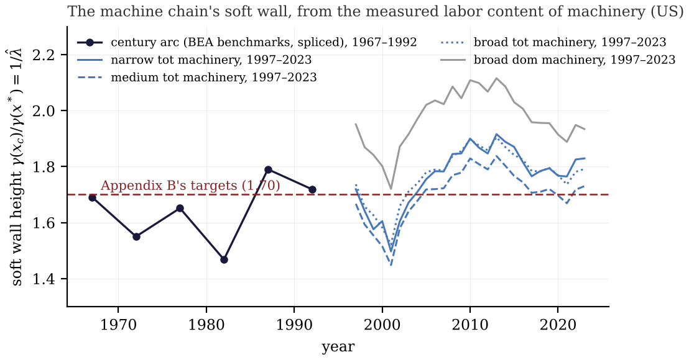
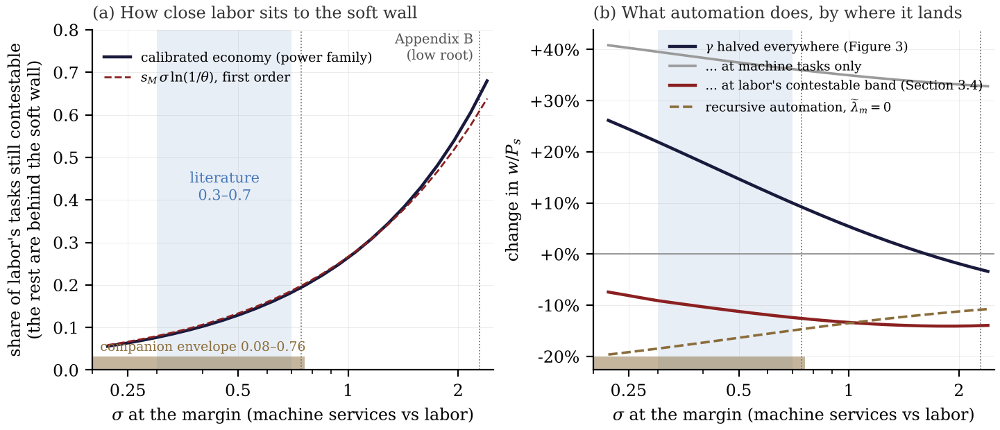
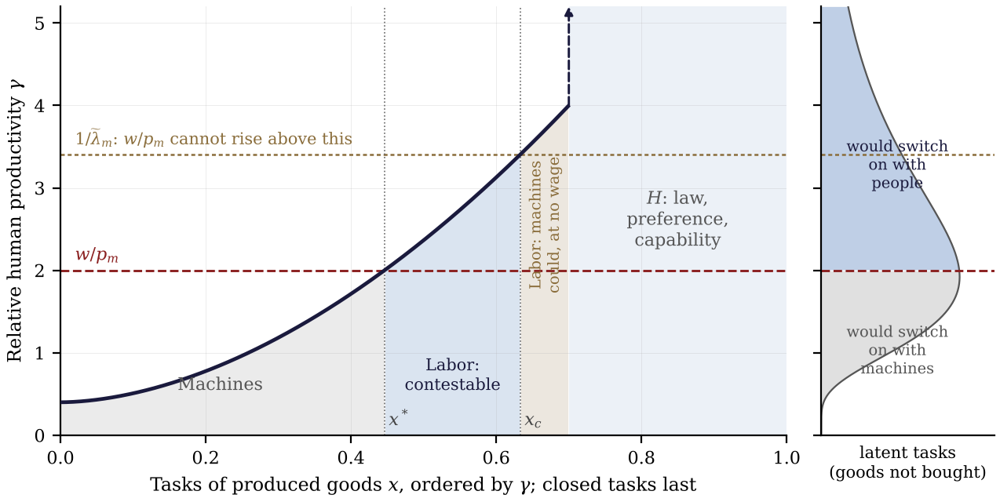
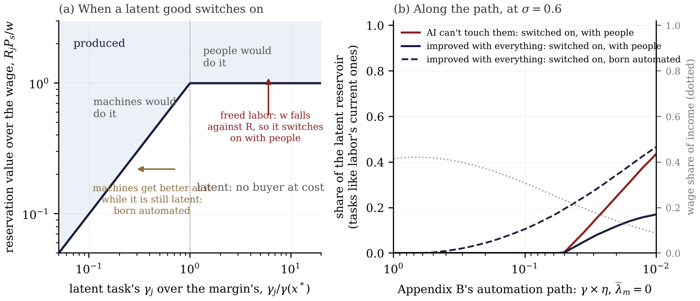

# Walls: what the overnight exploration found

*2026-11-16, overnight, on Stella's ask: "explore all these ideas and see which ones you like most; calibrate, check
some data, try different ideas, ponder, repeat." Everything is new in `walls/`; nothing in `pinning/` changed. The
solver (`code/model.py`) is Appendix B's economy with the schedule as a plug-in and an optional hard wall, gated
against `pinning/code/appendix_b.py` (`checks/check_model.py`, 18/18).*

## The short version, ranked by how much I like it

1. **The soft wall is the wall labor actually faces, and the data put labor close to it.**
   - A task is behind the soft wall when the machines that would replace an hour of work embody at least an hour of
     labor (γλ̃_m ≥ 1), so no wage makes them cheaper.
   - Appendix B's shares put that wall at 1.70 times the margin's γ, whatever the schedule's shape. The λ thread's
     data put it at 1.45–1.92 since 1967.
   - With σ from the literature, 77–94% of labor's tasks sit behind it.
   - Your asymptote is real: in rent units, at this wall, a few percent of tasks past the margin.
2. **Where automation lands decides its sign, and Figure 3 lands it in the wrong place.**
   - Machines getting better at what they already do raises w/P_s by about 35%. Getting better at labor's band near
     the margin lowers it by 7–14%.
   - Figure 3's "γ halved at every task" mixes the two. Its sign flips at σ ≈ 1.6, so at literature σ it raises the
     real wage.
   - The paper's own definition of task automation (Section 3.4: "at tasks near the assignment margin") lowers it
     on every calibration.
3. **The backward calibration leaves one shape parameter free, and σ pins it.**
   - Appendix B's two roots are two points on a continuum. The printed instance implies σ = 2.28 at the margin.
   - The literature says 0.3–0.7, and the companion envelope independently says 0.08–0.76.
4. **H decides the endgame, and the calibration cannot see it.**
   - Any hard wall above the margin leaves the calibrated economy unchanged.
   - Along the automation path, participation floors at 5.9 × |H|, whatever σ is.
5. **Latent goods make reinstatement testable.**
   - Under general-purpose automation, most latent goods switch on already automated.
   - Reinstatement with people happens only once real wages fall, and it is bought increasingly by owners.
   - In general equilibrium, a reservoir that automation can't touch is a floor, like H, but a low-wage one
     (w/P_s 0.63 against 2.77 today). If automation reaches the latent tasks, the floor all but vanishes.
6. **An asymptote in γ at H remains the least honest picture.** The jump stays.

## 1. The soft wall

**Definition.** Equation (5)'s denominator closes every task where γλ̃_m ≥ 1, because the machine-hours that would
replace an hour of work embody at least an hour of labor. In γ units this caps the wage line: w/p_m < 1/λ̃_m at any
wage. In rent units the replacement value climbs to a vertical asymptote at the first such task, x_c. Appendix B
already has this wall (its "ceiling", 0.946); the paper never draws it.

**The calibration pins it.** Two of Appendix B's seven targets fix it alone: labor is 0.47 of a machine's build cost,
and machine services are 0.20 of it. Then γ(x_c)/γ(x*) = (1 − 0.20)/0.47 = 1.70, whatever the schedule's shape.
Equivalently, the full-chain labor share of machine services at the margin is θ = 0.59.

**The data put it in the same place.** θ is what the λ thread measures as λ̂: the vertically integrated
labor-compensation share of machinery output. So 1/λ̂ is the wall's height over the margin. It ran 1.45–1.92 over
1967–2023 (century arc, spliced, and family A's "tot" members), and the calibration's 1.70 is mid-range.

**How close labor sits to it.** To first order, the share of labor's tasks still contestable is

  (x_c − x*)/(1 − x*) ≈ s_M · σ · ln(1/θ),

where s_M is machines' share of final-task cost (0.5 in the calibration). Three measurable numbers. The formula
holds within about 0.01 on two schedule families (power and exponential) for σ up to 1.5
(`code/formula_check.py`).
- With σ = 0.3–0.7 (literature) and θ = 0.52–0.69 (data), only 6–23% of labor's tasks are contestable. The rest are
  behind the soft wall.
- At σ = 0.6 the margin sits at x* = 0.830 and the wall at x_c = 0.856.
- The printed instance (σ 2.28) has 68% contestable.

## 2. The backward calibration leaves one shape free; σ pins it

The shares pin the margin at x* = 1 − participation × (1 − chain share)/(baskets a person) = 0.83, the return
ρ = 0.093, and the soft wall. They put only one condition on the schedule: J(x*) = γ(x*)(1 − x*), machines' cost of
the tasks below the margin equals labor's cost of the tasks above. In the power family γ = c + x^k, every k > 3.88
meets it with its own c. Appendix B's roots (k 4.355 and 15.498, both with g0 = 0.01) are two members of that
family (`code/sigma_family.py`).

At this calibration the elasticity of substitution between machine services and labor at the margin is
σ = 2γ/(γ′(1 − x*)): 2.29 on the low root (the printed instance: 2.28) and 0.744 on the high root. What the data
say:

| source | σ |
|---|---|
| Chirinko (2008), weight of the evidence | 0.40–0.60 |
| Oberfield and Raval (2021), U.S. manufacturing aggregate | 0.5–0.7 |
| Gechert, Havranek, Irsova and Kolcunova (meta-analysis of 3,186 estimates) | mean 0.9; 0.3 after correcting for publication bias |
| Karabarbounis and Neiman (2014), the high outlier | about 1.25 |
| the companion envelope, read through this calibration (`code/flip_check.py`) | 0.08–0.76 (median 0.24) |

The companion read is independent. With this calibration, the share of labor's employment that flips per log point
of w/p_m is exactly σ/2. So twice the flipped mass over the waterline's log rise is a σ: 6 waterline members times
3 flip rules give 0.08–0.76.

Calibrating σ = 0.6 as an eighth target gives k = 19.47 and g0 = 0.0052, a 193:1 capability ratio instead of 100:1.
Every other target holds as printed. Under a second functional form, γ = c + e^{βx}, the same σ gives the same
answers to within a percent (`code/formula_check.py`). Given the shares, σ is a sufficient statistic for the
schedule near the margin.

## 3. Where automation lands

Each experiment multiplies chosen tasks' γ by 0.5 and re-sorts the schedule (`code/landing.py`). Results are
changes in w/P_s:

| machines get twice as good at… | printed instance's root (σ 2.29) | σ 0.6 |
|---|---|---|
| tasks they already hold | +32.9% | +36.8% |
| labor's contestable band, x* to x_c (Section 3.4's definition) | −14.0% | −11.9% |
| only the tasks behind the soft wall | −4.3% | −3.1% |
| every task (Figure 3) | −3.0% | +12.1% |
| recursive automation, λ̃_m = 0 (Figure 3) | −10.9% | −15.6% |

- **Figure 3 versus Section 3.4.** Figure 3's experiment is mostly the productivity effect on tasks machines already
  hold, so its sign depends on σ and flips near 1.6. Section 3.4's definition, capability gains near the margin, is
  the displacement experiment, and it is negative on every member.
- **Recursive automation is the biggest negative channel at literature σ** (−15% to −18%). Labor sits near the soft
  wall, and λ̃_m is what moves that wall.
- **Long paths.** Along Appendix B's path (λ̃_m = 0, γ × η), σ = 0.6 is non-monotone and much slower than the low
  root. w/P_s goes 2.33 → 2.85 (η 0.2) → 1.32 (η 0.01), and participation is 0.38 at η 0.01 (printed: 0.13).

## 4. The hard wall and the endgame

Any hard wall H above the margin leaves the calibrated equilibrium unchanged; I checked xH = 0.95, 0.90 and 0.85 on
both roots. Along Appendix B's automation path, participation at η = 0.001 (`code/hard_wall.py`):

| \|H\| | low root | σ 0.6 |
|---|---|---|
| 0 | 0.02 | 0.14 |
| 2% | 0.12 | 0.14 (margin not yet at H) |
| 5% | 0.30 | 0.29 |
| 10% | 0.59 | 0.59 |
| 15% | 0.89 (w/P_s 6.1) | 0.89 |

- **The floor is the same formula on every member.** It is (T/h)·|H| = 5.9·|H|. T/h, the baskets a person that land
  allows once machine work is free, is pinned by the shares. σ only changes how soon the margin reaches H.
- **These floors are upper bounds.** Appendix B's single good uses every task in fixed proportion, so no one can
  switch away from goods that need H. That is the extreme case of Appendix E's σ_H < 1.

## 5. Latent goods and reinstatement

**The complete schedule.** It has five categories:
- tasks machines do;
- tasks labor holds that machines could contest;
- tasks labor holds behind the soft wall (machines could do them, but at no wage);
- H (law, preference, residual capability);
- latent tasks, belonging to goods nobody buys at cost.

`code/complete_schedule.py` draws it on Figure 1's printed schedule, with the soft wall at 1.70 × w/p_m:

**When a latent good switches on.** Normalize by the margin: g = γ_j/γ(x*) and ρ = R_j P_s/w. A latent good is
viable when ρ ≥ min(1, g). It employs people when g > 1. It switches on in two ways:
- **Freed labor:** w falls against its value.
- **Cheaper machines:** p_m γ_j falls. Under general-purpose automation, γ_j itself falls while the good is still
  latent, so it is born automated.

**Along Appendix B's path at σ = 0.6** (partial equilibrium at the path's prices; a reservoir of tasks like labor's
current ones; `code/latent.py`):
- **If automation can't touch the latent tasks,** 44% switch on by η 0.01, all with people. But it starts only once
  w/P_s turns down (η ≈ 0.05): reinstatement follows the wage down rather than holding it up.
- **If they improve with everything else,** 17% switch on with people and 47% switch on already automated.
- **The wage share of income falls from 0.42 to 0.09,** so the buyers of reinstated work become owners.

**In general equilibrium** (`code/latent_ge.py`), the reservoir's labor demand enters labor-market clearing and its
machines compete for land. The reservoir is sized so that it would take 0.3 hours a person if people did all of it.
Participation and w/P_s at η = 0.001:

| | low root | σ 0.6 |
|---|---|---|
| no reservoir | 0.018 / 0.04 | 0.141 / 0.36 |
| reservoir that automation can't touch | 0.222 / 0.63 (latent services absorb all labor from η 0.01) | 0.220 / 0.63 |
| reservoir improved with everything else | 0.018 / 0.04 | 0.150 / 0.39 |

- **An untouched reservoir is a floor, like H.** Late in the path, machines hold every final-good task, and the
  latent services set the wage.
- **But it is a low-wage floor:** w/P_s 0.63, against 2.77 today.
- **If automation reaches the latent tasks, the floor all but disappears.** Reinstatement through latent goods is a
  stabilizer only to the extent that automation is not general-purpose.

**For the paper.** This turns Section 2.3's choice ("abstracts from the creation of new labor tasks") into an
assumption about a distribution: that the latent reservoir above the margin is thin, or reached by automation first.
It also gives O*NET's task births falling to zero since 2012 (the companion's series) a second reading: O*NET only
sees tasks inside human occupations, so it cannot see goods born automated.

On the three open questions, my choices: latency at the level of goods (it fits the cost recursion as written); a
fixed reservoir (it keeps the paper's no-new-tasks stance); and a remark in Section 2.3, with one line in Section 10.

## 6. Back to the figure question

- **The jump at H stays.** An asymptote in γ at H is never reached while λ̃_m > 0, because the soft wall comes first.
  At λ̃_m = 0 it needs capability to fade to zero, which nothing here supports.
- **The asymptote belongs to the soft wall, and that is where the data put labor.** It shows in rent units
  (`figures/toy_rent_units.png`), or as the cap 1/λ̃_m in γ units (`figures/complete_schedule.png`).
- **The complete schedule is a candidate Figure 1.** The catch is that λ̃_m is introduced only in Section 3.3.

## 7. For the paper (your calls; my lean in brackets)

1. **Figure 3's task automation → γ halved on labor's contestable band**, Section 3.4's own definition. Its sign
   holds on every calibration, and it makes Section 5's "both automation channels lower the real wage" hold
   regardless of the root. Showing both "at machine tasks" and "at the margin" would also put Acemoglu and
   Restrepo's productivity/displacement split in the paper's terms. [Strongest recommendation.]
2. **State σ in Appendix B.** The printed instance's 2.28 lies outside the literature, and a referee can compute it
   from the printed numbers. Either target σ ≈ 0.6 (k 19.5, g0 0.0052, 193:1) or state σ and why. Targeting σ makes
   item 1 necessary, because the uniform experiment turns positive. [State it at least.]
3. **Add one sentence on the soft wall** in Section 3.3 or Appendix B: the shares put it at 1.70 times the margin's
   γ, and 1/λ̂ has measured 1.45–1.92 since 1967. [Cheap and on message.]
4. **Restate Section 2.3's choice as an assumption** about the latent reservoir above the margin, with the
   born-automated point and O*NET's blind spot. [A remark.]
5. **Treat |H| as a scenario parameter** in Appendix E / Section 10: in Appendix B's economy the floor is (T/h)·|H|,
   an upper bound. [Optional.]
6. **Figure 1:** keep it, perhaps with a "γ = ∞" label; the complete schedule is an option. [Optional.]

## 8. Caveats

- **The two σ's are close but not identical.** The model's σ is between machine services and labor in final tasks,
  at the margin; the literature's is aggregate capital versus labor. In task models these are the same object
  (Oberfield and Raval's aggregate includes reallocation), but the match isn't exact.
- **θ is an average.** λ̂ is the average machinery's compensation share, not that of the machines at the margin.
  Chain wages are assumed to move with the marginal wage.
- **The companion read can be biased either way.** Occupational flips miss automation within occupations, which reads
  σ low. Flips caused by γ changes get charged to the waterline, which reads σ high. And w/c is not w/p_m.
- **The first-order formula drifts at large σ:** 0.71 actual against 0.66 predicted at σ 2.5.
- **The latent-goods results rest on illustrative choices.** The partial-equilibrium run uses the path's prices.
  The general-equilibrium run adds labor-market and land feedback but keeps demand quasi-linear in baskets, so who
  holds income does not change what is bought. Both use a fixed reservoir with illustrative distributions (uniform
  positions, uniform distance to viability, size 0.3). Read only the signs, orderings and the contrast between
  untouched and general-purpose reservoirs.
- **The hard-wall floors are upper bounds:** one good, every task in fixed proportion, output limited by land.
- **Everything is on Appendix B's economy and its shares.** Nothing was re-estimated, and the only new data are the
  verified σ figures.

## 9. Files

| | |
|---|---|
| `code/model.py` | plug-in solver, hard wall, closed-form backward calibration, σ at the margin, re-sorted schedules |
| `checks/check_model.py` | 18 gates against `appendix_b.py` and the seven targets |
| `code/sigma_family.py`, `code/sigma_figure.py` | the calibrated family, σ, the experiments; `figures/sigma.png` |
| `code/formula_check.py` | s_M σ ln(1/θ) on two families |
| `code/soft_wall_data.py` | 1/λ̂ from the λ thread; `figures/soft_wall_data.png` |
| `code/flip_check.py` | σ from the companion envelope |
| `code/landing.py` | where automation lands; long paths |
| `code/hard_wall.py` | the hard-wall endgame |
| `code/latent.py`, `code/complete_schedule.py` | latent goods (partial equilibrium); `figures/latent.png`, `figures/complete_schedule.png` |
| `code/latent_ge.py` | latent goods in general equilibrium, including the regime where they absorb all labor |
| `code/toys_wall_shapes.py`, `code/toy_law_only.py`, `code/calib_options_first_pass.py` | the evening's mock-ups (`figures/toy_*.png`) |
| `results/*.json` | every number above |

## Sources (σ)

- Chirinko (2008), "σ: The long and short of it", *Journal of Macroeconomics* 30(2): [IDEAS](https://ideas.repec.org/a/eee/jmacro/v30y2008i2p671-686.html)
- Oberfield and Raval (2021), "Micro Data and Macro Technology", *Econometrica*: [paper](https://economics.sas.upenn.edu/sites/default/files/filevault/u21/Oberfield_Raval.pdf)
- Gechert, Havranek, Irsova and Kolcunova, "Measuring Capital-Labor Substitution: The Importance of Method Choices and Publication Bias": [RePEc](https://econpapers.repec.org/RePEc:osf:metaar:6um5g), [CEPR DP15687](https://causalclaims.trfetzer.com/paper/DP15687.html)
- Karabarbounis and Neiman (2014), "The Global Decline of the Labor Share": [NBER w19136](https://www.nber.org/papers/w19136.pdf)
- Bank of Canada staff working paper 2019-3 (σ near or below one): [pdf](https://www.bankofcanada.ca/wp-content/uploads/2019/01/swp2019-3.pdf)
